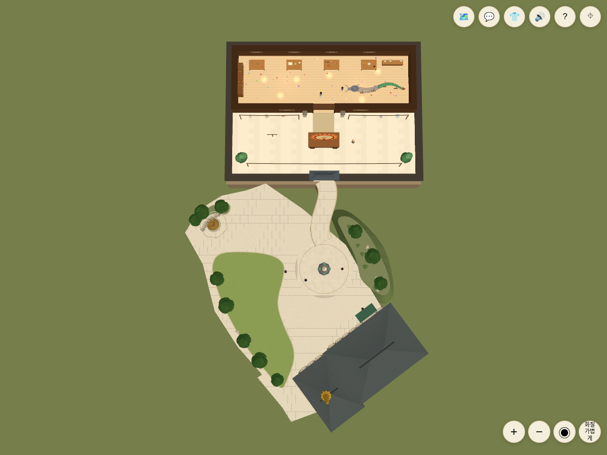
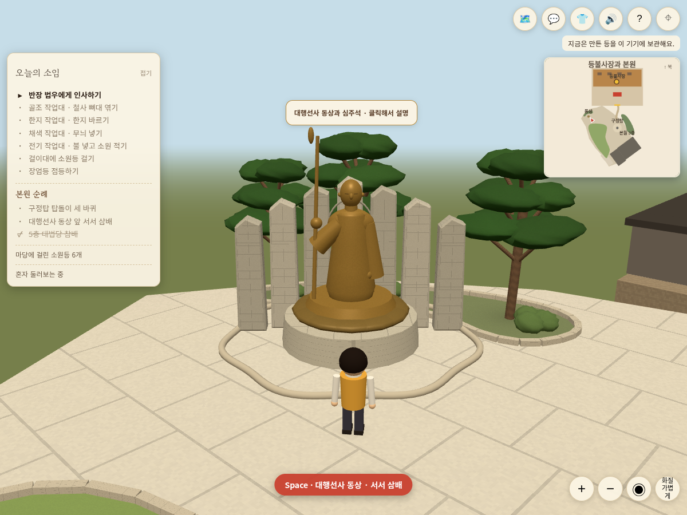
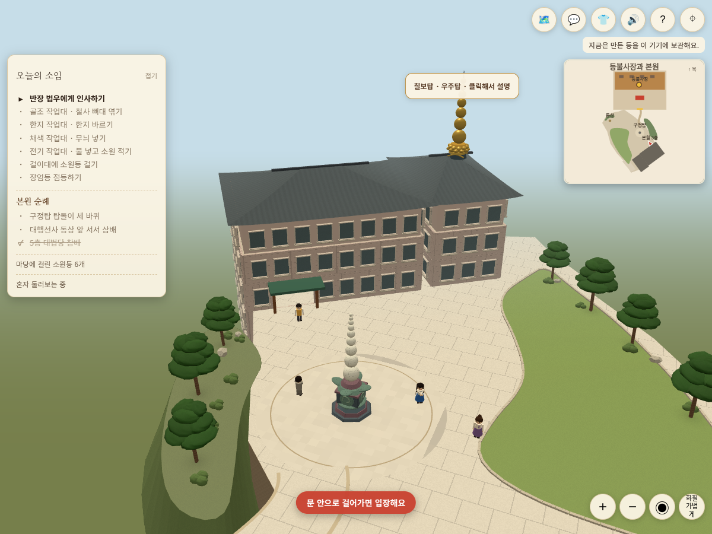

# 승인 조경안 적용 — 중앙 잔디·참배 마당·오른쪽 식재

사용자는 중앙 녹색 사각면이 천막이라고 확인한 뒤 그 자리와 주변을 잔디로 바꾸라고 요청했다. 이어 동상 앞과 도량탑 주변의 잔디를 물리고, 구정탑 오른쪽을 자연스럽게 채운 마지막 스케치를 승인했다. 이 구현은 그 **사용자 변경안**이며 실제 도량의 최신 위성사진/실측 복원이 아니다.

## 변경

- 여러 녹지 면을 중앙의 단일 잔디로 통합했다. 동상 앞과 구정탑 원형 보행원 주변에서 잔디를 물려 석재 마당을 넓혔다. 천막은 배치하지 않는다.
- 오른쪽 가장자리에 소나무·낮은 관목·자연석과 식재 지면을 배치하고 낮은 외부 지면까지 이어지는 사면으로 받쳤다. 기존 통행 가능한 도량을 임의로 넓히거나 출입길을 새로 만들지는 않았다. 새 바깥 식재는 장식 지형이다.
- 옛 외부 구형 나무 대신 11그루의 층진 소나무 수관과 가지를 구성했다. 수관은 나무별 인스턴스 묶음으로 기존 가림 처리에 등록된다. 낮은 관목과 돌은 인스턴스화했다. 모바일 수관은10×7, PC는14×10 구체를 사용한다. 실제 잎/수종을 스캔한 모델이나 사진 수준의 정밀 모델은 아니다.
- `approvedLandscape.js`의 동일 데이터가 잔디·식재 렌더, 미니맵, 수목·돌 충돌에 사용된다. `classicPlacement.js`의 옛 사진 판독 녹지 내보내기는 과거 비교 화면용으로 남기고 운영 도량의 녹지는 승인 데이터로 대체했다.
- 저층 경계석은 잔디와 동상 뒤 식재에만 적용했다. 도량 외곽 담장, 새 조명·라이브러리·사진 텍스처는 추가하지 않았다.
- 동상·구정탑·법당·칠보탑·작업장의 위치/방향, 본원 층고·3층 연결문, 길 끝과 기존 탑돌이·제작·설명·자동 시점은 유지했다. 본원1층 앞면/출입구는 여전히 별도 스케치 단계다.

## 검증

- 신규3개 테스트를 실패 상태에서 먼저 확인한 뒤 통과했다: 천막 주변 단일 잔디 통합, 고정 좌표·동상 앞/탑/문/길 여유, 잔디의 기존 도량 내부 배치·식재 지면/오른쪽 사면 연결.
- 탑 반경5.8의360방향을 잔디·식재가 침범하지 않으며 수목/바위는 그보다 더 밖에 있다. 기존 탑돌이 여유·연결길·법당 접근·좌표 보존 테스트와 함께 전체113개 통과.
- 최종 npm run build와 git diff --check 통과. 기존 Three.js 청크 크기 경고는 유지된다.
- 독립 리뷰: critical/important 문제 없음. 사면 지지, 좌표 공유, 통행 여유, 수관 가림, 비용 상한을 검토했다. 수관11묶음/110개, 가지·줄기110개, 관목42개, 바위6개 인스턴스다.
- Chromium PC1200×900 / 모바일 모형390×844에서 전체 보기, 동상 접근·직접 클릭 설명, 자동 탑돌이 시작/이동 입력으로 중단, 법당 실제 키보드/터치 조이스틱 걸어서 입장·퇴장 통과. 두 환경의 페이지 오류0건.
- 실제 아이폰 Safari/GPU·운영 DB 쓰기·동시접속 부하·운영 배포는 검증하지 않았다. PR만 갱신하며 병합·운영 배포는 클로드가 진행한다.

## 실제 실행 화면

생성 스케치가 아닌 현재 소스의 브라우저 화면이다. 전체 보기는 북쪽 위다.

