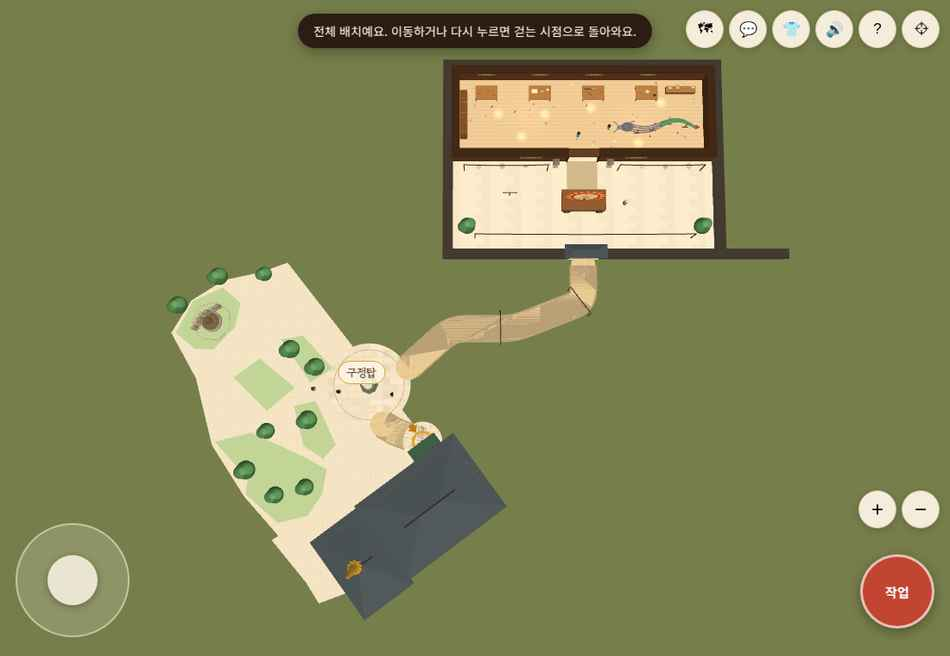
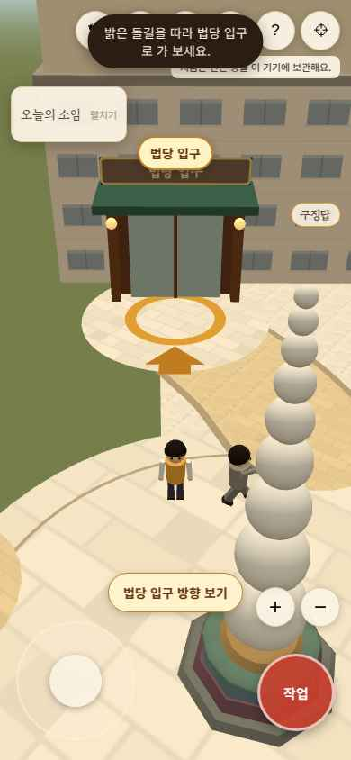

# 승인 스케치 적용 및 기능·카메라·음악 점검

기준 main: `87da5437ca8c16f03d50b026a6d5fc8a60420a98` (PR #32 병합 상태).
사용자는 #32의 구정탑 이동을 취소하고, **위성 기준 동상·구정탑을 고정하며 법당만 방향 그대로 평행 이동**하는 스케치를 승인했다. 이 문서와 아래 좌표가 이전 북동쪽 배치안보다 우선한다.

## 실제 구현한 배치

- 구정탑을 PR #22 기준 변환 좌표 (26.4803,42.2034)로 복원하고 고정.
- 동상 중심은 같은 기준의 기존 좌표에 고정. 동상을 아래로 내리거나 법당과 수평 정렬하지 않는다.
- 법당 두 날개·문·칠보탑을 **같은 벡터 (+4,+2.4)**로 평행 이동. 길이·직각·회전각은 유지.
- 구정탑 원형 마당 가장자리에서 법당 외곽까지 약 6.05 게임 칸의 여유 확보.
- 등불사장 전체를 **동쪽 +36칸** 이동. 작업장은 실제 세계 x36~72, z0~26.6이다. 구정탑 기준 북동쪽이며 가로로 맵이 넓어진다.
- 작업대·NPC·걸이줄·장엄등·제작 표식·미니맵·입구·충돌·등 소원 툴팁·밤 입자를 함께 이동했다. 내부 로컬 좌표를 유지하되 세계 좌표로 변환한다.
- 작업장과 도량은 같은 세계에서 돌길로 연결된다. 순간이동·공간 선택 없음.
- 구정탑 탑돌이 반지름 4 및 양옆 .6칸을 비우고, 길·나무·안내 인물·연등 기둥이 막지 않도록 관리.
- 기존 실시간 경계 126×70 안에 둔다. 서버 프로토콜/운영 환경 변수 변경 없음.

수치는 가상 공간의 칸이며 실제 m 또는 위성 실측값이 아니다. 원래 기준 배치의 방향을 보존하되 승인된 간격 변경을 적용했다.

## 카메라·사용성

- 기본 뒤따라가기, 드래그·Q/R 회전, 휠/핀치/확대 버튼 유지.
- **전체 배치 보기(⌖)** 추가. 북쪽 위로 작업장·도량·법당을 함께 보여 주며 가로/세로 화면 비율에 맞춘다. 다시 누르거나 이동하면 걷는 시점으로 돌아간다.
- 전체 보기에서는 가리는 소임·미니맵을 감추고 그림자 렌더를 꺼 비용을 줄인다.
- **법당 입구 방향 보기**는 시선만 돌리지 않고 캐릭터와 입구가 함께 보이도록 거리를 조절한다. 직접 걷고, 가까워지면 기본 시점으로 부드럽게 복귀한다. 수동 회전·확대는 안내 구도를 해제한다.
- 미니맵을 넓은 배치에 맞춰 가로형으로 변경. 입구 안내 중에는 미니맵이 문을 가리지 않게 한다.
- 이전 입구의 차양·간판·문턱·화살표·실제 대법당 링크 유지.
- 문턱 앞에서 실제 S 키로 작업장 밖까지 걸어서 나가는 브라우저 검사 통과 (x54,z25.4 → z28.41). 검사 위치 이동은 문턱 시작점에만 사용했다.

## 배경음악

기존 드론·무작위 종 위주의 음악을 **느린 오음계 선율·쉼표·부드러운 화음**으로 교체했다. Web Audio 자체 생성이며 외부 음원/파일/라이브러리를 추가하지 않는다.

주 화면은 배경음악 모듈 자체가 빠져 효과음만 나던 상태여서 새 음악을 연결했다. 기존 법당 등 createBgm 사용 화면도 같은 새 곡을 쓴다. 기존 켜기/끄기 저장 키를 유지한다.

- 사용자 입력 이후에만 오디오 컨텍스트와 재생을 시작한다.
- 하나의 음악 컨텍스트·반복 타이머만 유지한다.
- 음소거/화면 숨김에서 노드를 정리하고 컨텍스트를 일시 중지한다.
- 오디오 재개가 거절되면 반복 노드/타이머를 만들지 않는다.
- 주 화면의 소리 버튼으로 음악과 효과음을 함께 끄고 켠다. 이미 울리던 효과음도 음소거 때 중지한다.
- 브라우저에서 오디오 컨텍스트 running, 음소거 저장 off, 화면 전환 및 거절 경로 단위 테스트 확인. 실제 기기 음량·음색의 주관적 청음은 별도 확인이 필요하다.

## 누락 기능·디자인 대조표

| 항목 | 판정 및 이번 처리 |
| --- | --- |
| 배경음악 | 주 화면 연결 누락을 복원하고 곡 교체 |
| 바깥길 연등 줄 | 빈 배열로 사라진 장식을 복원: 낮은 기둥·줄 2개·작은 등 4개, 밤 발광. 개별 PointLight를 추가하지 않음 |
| 제작 진행 이어하기 | 완료한 작업대 단계가 새로고침/법당 왕복 때 사라지던 문제 수정. stage/craft를 이 기기에 저장하고 잘못된 데이터는 초기화 |
| 골조·한지·채색·전기·소원·걸기·점등 | 기존 공용 lanternCraft 사용. 실제 브라우저에서 전 과정 로컬 완료 확인 |
| 작업장 NPC·옷 고르기·소원등 모델·장엄등 | 기존 구성 보존, 실제 이동 좌표에 함께 연결 |
| 방명록·대화·공유 소원등 | 기존 모듈과 초안/실패 보존 로직 유지. 운영 DB 쓰기·삭제는 이번에 수행하지 않음 |
| 자동 탑돌이·동상 서서 삼배 | 기능 보존. 경로/충돌 및 바퀴 계수 테스트 유지. 브라우저 실시간 세 바퀴 완주를 검증했다고 표현하지 않음 |
| 법당 내 절하기 | 기존 법당과 선택 메뉴 유지. 실제 링크 입장 및 새 문 앞으로 복귀 확인 |
| 예불·법회·좌선 안내 | 원본 campusScene에 관련 함수는 남아 있으나 기존 법당 메뉴에 연결되지 않은 복원 대상. 이번에 복원됐다고 표현하지 않음 |
| 실물 조형 디테일 | 기존 구정탑·동상·본존불·목탱화·칠보탑의 간략 모델 유지. 실측/실물 세부 복원 완료로 표현하지 않음 |

### 다음에 복원할 구조

예불·법회·좌선은 현재 사용되지 않는 원본 함수를 그대로 복제하지 말고 공용 체험 모듈로 추출한다. 기존 beopdang의 인형 자세·종료·초점 복귀·절 횟수와 연결하고, 좌선 호흡 안내부터 단계적으로 연결한다. 예불문·법문은 공식 내용과 출처를 확인해 제공하며 임의 문구를 실제 가르침으로 표시하지 않는다. 이는 검토 결과이며 현재 연결된 기능이 아니다.

## 최종 검증

- 깨끗한 의존성 설치 npm ci 성공, npm run build 성공.
- node --test **86개 통과**. 기준 좌표 고정·법당 평행 이동·작업장 변환/왕복·보행/탑돌이 여유·오디오 중복/음소거/재개 거절·제작 진행 검증 포함.
- npm audit **0건**, git diff --check 통과.
- Chromium: 최초 이름/모습 선택, 이동한 반장 대화, 네 작업대, 새로고침 후 단계 복구, 소원등 로컬 걸기·점등, 실제 문턱 보행, 전체 보기 왕복, 모바일 입구 안내/미니맵/음소거/법당 왕복. 확인 흐름 pageerror 0.
- 390×844 터치 화면 게임·입구 안내 axe 검사 검출 오류 0건. 이는 전체 보조기술 접근성 보장이 아니다.
- 소프트웨어 렌더의 지연 때문에 첫 데스크톱 클릭 검사가 시간 초과한 뒤 터치/경량 렌더 환경에서 기능을 재검사했다. 이 환경의 FPS를 실기기 성능으로 해석하지 않는다.
- Three.js 기존 큰 청크 경고는 남는다. 80명 실제 동시 접속/실기기 부하·운영 DB 쓰기·실제 통신 단절/재접속은 이번에 검증하지 않았다.
- 독서 홈페이지·운영 DB·서버·배포 환경 변수는 수정하지 않는다.
- 이전 배치를 열어 둔 탭은 새 배포 후 새로고침해 같은 좌표계를 사용한다.

PR 본문은 기존 사용자 요청대로 “검증 못 했음” 한 줄로 두고 실제 결과/제약은 이 문서에 기록한다.
