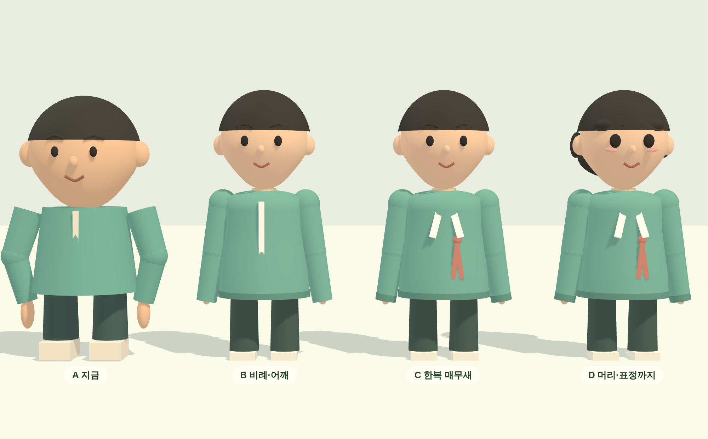
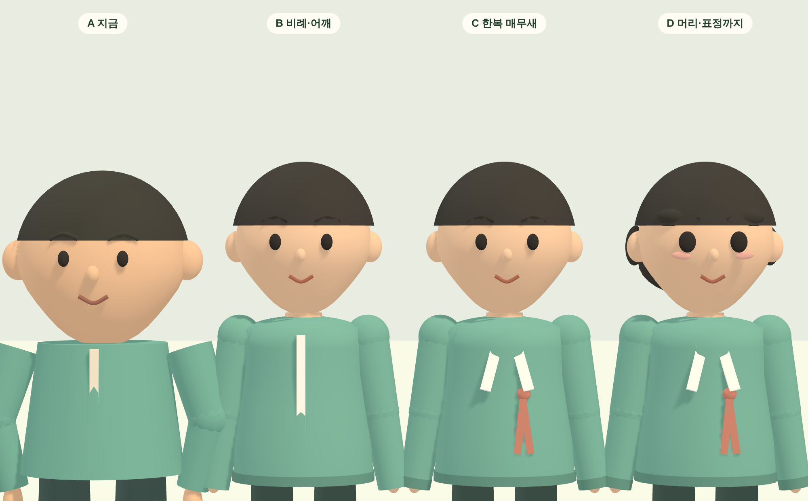
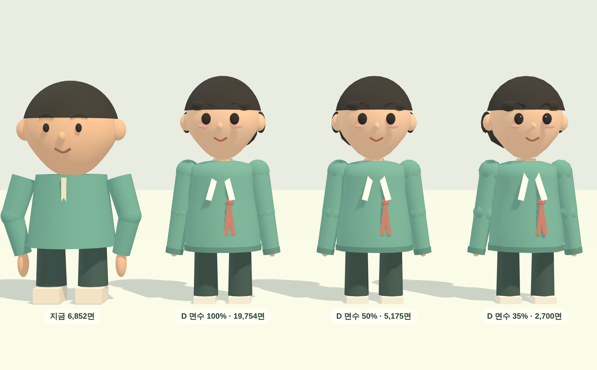

# 캐릭터 기획안 — 도형 조합에서 사람으로 (2026-11-14)

사용자 요청: *"캐릭터 좀 예쁘게 해봐. 시안부터 보여줘."*
시안은 `docs/concept/` 의 PNG 셋, 시안 코드는 `docs/concept/character-variants.js` 입니다.
**아직 운영 코드는 한 줄도 바꾸지 않았습니다.**

## 1. 왜 안 예쁜가 — 재 본 것

`avatar-social.js` 의 `createActor()` 가 캐릭터를 통째로 코드로 깎습니다. 재 보니:

| | 값 |
| --- | --- |
| 키 | 2.11 |
| 머리 | 0.90 (키의 **43%**) → **2.2 등신** |
| 몸통 | 원뿔 하나 (`CylinderGeometry(.34, .43, .68)`) |
| 목 | **없음** (머리가 몸통에 바로 얹혀 있음) |
| 머리카락 | 반구 하나 (`SphereGeometry` 0.43π) |
| 옷 디테일 | 흰 리본 판 **한 장** |
| 메시 / 삼각형 | 24개 / 6,852 |

문제는 "못생겼다"가 아니라 **세 가지가 구체적으로 빠져 있다**는 것입니다.

1. **등신이 2.2** — 건물은 합각지붕에 단청까지 그려 놓고 사람만 장난감 비례입니다.
2. **목이 없고 어깨가 없다** — 머리가 몸통 위에 얹힌 눈사람 실루엣입니다.
3. **머리카락이 반구 한 개** — 이마를 가로지르는 직선이 생겨 헬멧처럼 보입니다.
   화면에서 사람을 알아보는 건 거의 이 선입니다.

## 2. 시안 — 한 단계에 하나씩

| | 무엇을 고치나 | 삼각형 |
| --- | --- | --- |
| **A 지금** | — | 6,852 |
| **B 비례·어깨** | 3등신(머리 0.75/키 2.21) · 목 · 회전체 몸통(허리·어깨) · 다리 길이 | 11,686 |
| **C 한복 매무새** | 동정 V · 고름 · 아랫단/소맷단 띠 (흰 리본 한 장 대체) | 12,494 |
| **D 머리·표정** | 앞머리 결(헬멧선 제거) · 구레나룻 · 큰 눈 + 눈빛 · 볼 | 19,754 |

- 몸통을 `CylinderGeometry`(원뿔)에서 **`LatheGeometry`(회전체)** 로 바꾼 것이 B 의 핵심입니다.
  아랫단이 퍼지고 허리가 들어가고 어깨에서 둥글게 닫힙니다. 원뿔로는 안 됩니다.
- C 의 깃·고름은 **몸통 표면 위에 얹습니다**(`onSkin()`). 처음에 고정 z 로 두었더니
  전부 옷 속에 묻혀 안 보였습니다.
- D 의 구레나룻은 **눈보다 뒤(z −0.42)** 에 둡니다. 앞에 두면 머리가 눈을 덮습니다.

## 3. 비용 — 더 예쁘고 더 싸집니다

D 를 그대로 쓰면 지금의 **2.9배**입니다. 80명이면 1.58M 삼각형이라 휴대폰에서 위험합니다.
그런데 이 모양은 **면 수를 낮춰도 거의 그대로입니다.**

| D 의 면 분할 | 삼각형 | 지금 대비 |
| --- | --- | --- |
| 100% | 19,754 | 2.9배 |
| **50%** | **5,175** | **0.76배 (지금보다 쌈)** |
| 35% | 2,700 | 0.39배 |

**50% 에서 100% 와 눈으로 구분이 안 됩니다.** 구(球)를 22×16 으로 쪼개 놓은 것이
낭비였을 뿐입니다. 그래서 이 작업은 성능을 깎는 게 아니라 **같이 줄입니다.**

- 내 캐릭터·가까운 사람: 분할 70% (9,485) — 얼굴이 크게 보이는 자리
- 먼 사람: 분할 35% (2,700) — 지금의 40%

## 4. 추천

**B → C → D 를 이 순서로 전부 합니다.** 셋이 서로 다른 문제를 고치고, 셋 다 같은 함수
안에서 끝납니다. 하나만 고르라면 **B** 입니다. 비례와 목이 바뀌는 순간이 가장 크게 달라집니다.

## 5. 깨지면 안 되는 것 (구현 전 확인 목록)

- **관절 이름과 개수.** `poseRig()` 가 `{root, body, torso, head, arms, elbows, wrists, hands, legs}`
  를 그대로 받습니다. 합장·반배·절·걷기가 전부 여기 걸려 있습니다. 모양만 바꾸고
  뼈대는 손대지 않습니다.
- **저장된 외모.** `appearance{gender, hair, skin, hairColor, robeColor}` 를 그대로 받습니다.
  `hair` 는 `short/bob/bun/shaved` 넷이라 **새 머리 모양을 네 가지 다** 만들어야 합니다.
  (시안은 `short` 하나만 만들었습니다.)
- **얼굴 세 가지.** `FACE{neutral, male, female}` 의 rx/ry/jaw/eye 값이 다릅니다.
  시안은 중립 하나로만 봤습니다. 셋 다 확인해야 합니다.
- **2D 초상.** 첫 화면·프로필 카드는 `portrait()` 의 SVG 입니다. 3D 만 바꾸면
  카드 속 얼굴과 마당의 얼굴이 어긋납니다. **같이 바꿉니다.**
- **옷차림.** `OUTFITS` 의 `apron`·`gold` 가 지금 몸통 좌표에 맞춰 붙어 있습니다.
  회전체로 바꾸면 자리를 다시 잡아야 합니다.
- **접속자 인형.** `makePeer()` 가 같은 함수를 씁니다. 면 수 정책을 여기서 가릅니다.

## 6. 하는 순서

1. **B** — 비례·목·회전체 몸통·어깨. `FACE` 세 가지와 걷기·절 동작 확인.
2. **면 수 눈금** — 분할 배율 하나를 넣고 가까운 사람 70% / 먼 사람 35%.
   80명 기준 삼각형 수를 재서 기록.
3. **C** — 동정·고름·단. `apron`·`gold` 자리 다시 잡기.
4. **D** — 앞머리·구레나룻·눈·볼. 머리 네 가지 전부.
5. **2D 초상** 맞추기.
6. 실기기에서 보기.

## 7. 아직 못 한 것

- 시안은 **`short` 머리·중립 얼굴 하나**만 세웠습니다. 여성/남성 얼굴, `bob`·`bun`·`shaved`,
  옷차림 변주는 아직입니다.
- 이 컨테이너의 3D 는 소프트웨어 렌더(약 3fps)라 **움직이는 모습**(걷기·합장·절)은
  확인하지 못했습니다. 정지 렌더만 봤습니다.
- 80명이 한 화면에 있을 때의 실제 프레임은 재지 않았습니다. 삼각형 수만 센 값입니다.
- 시안 코드(`docs/concept/character-variants.js`)는 브라우저에 끼워 넣어 돌린 것이고
  운영 코드가 아닙니다. 그대로 옮기지 않고 `createActor()` 안에서 다시 씁니다.
