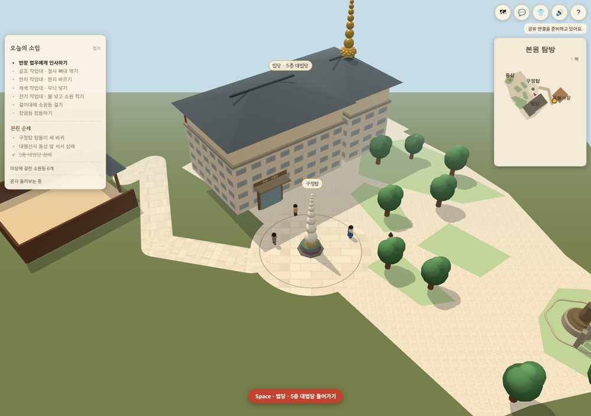
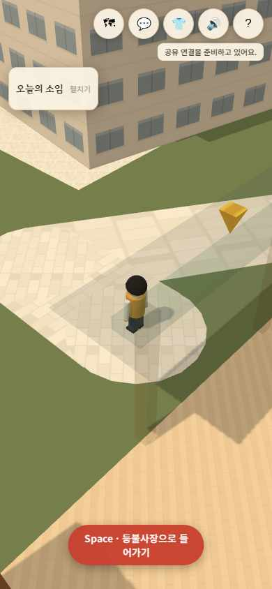

# 클로드 표현 + PR #22 배치

## PR #22 배치를 클로드 운영 맵에 적용 (2026-11-09)

최신 사용자 요청: 클로드 맵의 표현과 기능을 유지하고, 배치만 PR #22의 코덱스 맵 기준으로 자연스럽게 옮긴다. 시작 화면은 버전 선택 없이 예전 등불사장으로 들어간다. 아래 내용이 이전의 (7,54) 본관 / (21,48) 탑 / (12,32) 동상 / 사각 마당 지침을 대체한다.

- 기준은 PR #22 최종 head `6f63b89b450e2c2ad92cfd9b0ff0469765912295`. 후속 main의 `sitePreviewData.js`를 가져오지 않는다.
- `pr22Placement.js`는 해당 head의 본관 두 날개, 법당 문, 구정탑, 동상, 칠보탑, 가까이 붙인 작업장, 도량 외곽과 녹지를 보관한 고정 스냅샷이다.
- `classicPlacement.js`가 모든 평면 좌표에 같은 배율 1.2와 이동 (35,8)을 적용한다. 개별 건물·조형물을 따로 돌리거나 임의로 좌표를 재설정하지 않는다. 이 변환은 기존 126×70 접속 경계를 지키며 PR #22의 방향·상대 거리와 직각 건물 형태를 보존한다.
- 원본 작업대·장엄등·등 걸이대·NPC는 기존 내부 좌표 그대로 둔다. 내부 남문과 실제 외부 작업장 문은 짧은 화면 전환으로 왕복 연결한다. 작업장 외부는 PR #22 외곽에 세운 담장과 출입문으로 표현한다.
- 클로드의 재질·캐릭터·등 만들기·삼배·자동 탑돌이·공유/대화 기능을 유지한다. 법당 내부는 기존 `beopdang.html`을 사용한다.
- 본관 두 날개를 각자의 직사각형에 맞춰 세우고, 동상은 본관을 바라본다. 칠보탑은 같은 기준의 지붕 위치에 둔다. 본관 주변의 거대한 사각 포장 대신 사진 판독 도량 외곽/녹지와 탑 앞 원형 마당을 쓴다.
- 연결길은 작업장 모서리와 본관을 비켜 구정탑 앞마당까지 이어진다. 반지름 4 탑돌이와 양옆 .6칸 여유를 확보한다.
- 운영 맵은 클로드의 지면 y=0을 유지한다. 이번 변경은 평면 배치 이식이며 실제 지형 고저차/3층 로비 복원이 아니다. 문으로 기존 대법당에 들어가는 체험을 유지한다.
- 하나의 renderer와 기존 접속 채널을 사용한다. 실내/외 그룹과 타 공간의 인형을 숨긴다. 출입 때 위치를 즉시 알리며 다른 공간으로 이동한 인형은 긴 거리를 미끄러져 지나가지 않도록 보정한다. 서버 배포나 연결 수 확대를 포함하지 않는다.
- `deungbul.html`은 이미 main에서 선택 화면이 제거된 상태였다. 기존 시작 → 들어가기 → 모습 고르기를 그대로 유지한다. 운영 동선에 비교 화면을 추가하지 않는다.
- 미니맵은 실제 외부 다각형과 작업장 내부를 구분해 그리고, 다른 공간의 할 일은 해당 출입구로 안내한다.
- 독서 홈페이지, 운영 DB, 비밀키, 실시간 서버 설정은 변경하지 않는다.

검증 기록과 화면은 `docs/CLASSIC_PR22_LAYOUT.md`를 본다. PR 본문은 사용자 요청대로 “검증 못 했음” 한 줄을 사용한다.

## 검증

- Vercel 임시 Sandbox에서 npm ci 후 npm run build 성공. Three.js 기존 번들 크기 경고는 남아 있다.
- node --test: 73개 통과 후, 연결길 중앙과 포장 연결 검사 1개 추가 통과.
- 실제 충돌 함수를 사용해 반지름 3.4 / 4 / 4.6에서 반도 단위 전 구간을 검사했다. 막힌 점 없음.
- .4칸 격자 탐색으로 외부 작업장 문에서 법당 문·동상 앞·탑돌이 시작점까지 연결됨을 확인했다. 작업장 연결길 중앙도 검사한다.
- 기존 법당 입장 버튼의 실제 URL 이동과 복귀 문 앞 좌표 확인. 첫 시도는 검사 스크립트의 잘못된 버튼 이름으로 시간 초과했고, 실제 버튼 이름으로 재검사해 통과했다.
- Chromium 데스크톱 및 390×844 모바일 크기에서 시작 화면과 모습 고르기, 작업장 출입, 탑돌이 메뉴를 확인했다. 해당 흐름 pageerror 0.
- 개발 위치 이동으로 남문 자동 출구를 확인했고, 외부 문 작업 버튼으로 내부 복귀를 확인했다. 모바일에서 출입문 지붕이 캐릭터를 가리는 것을 확인하고 가림 투명 처리를 추가했다.
- 운영 Supabase/릴레이에 연결하지 않았으며 글·소원등 등 DB 쓰기를 하지 않았다. 실제 80명 부하, 실기기 성능, 운영 네트워크는 검증 못 했음.
- 이미지의 전체 배치 카메라는 개발 검토용이다. 일반 입장의 뒤따라가기 카메라는 유지한다.

## 화면

## 후속 작업

운영 배포에서 실제 네트워크 연결과 두 명 이상 작업장 왕복을 확인한다. 80명 안정성은 별도 부하 검증이 필요하다. 실제 외관 세부 복원이나 지면 고저차 복원이 끝났다고 설명하지 않는다.
