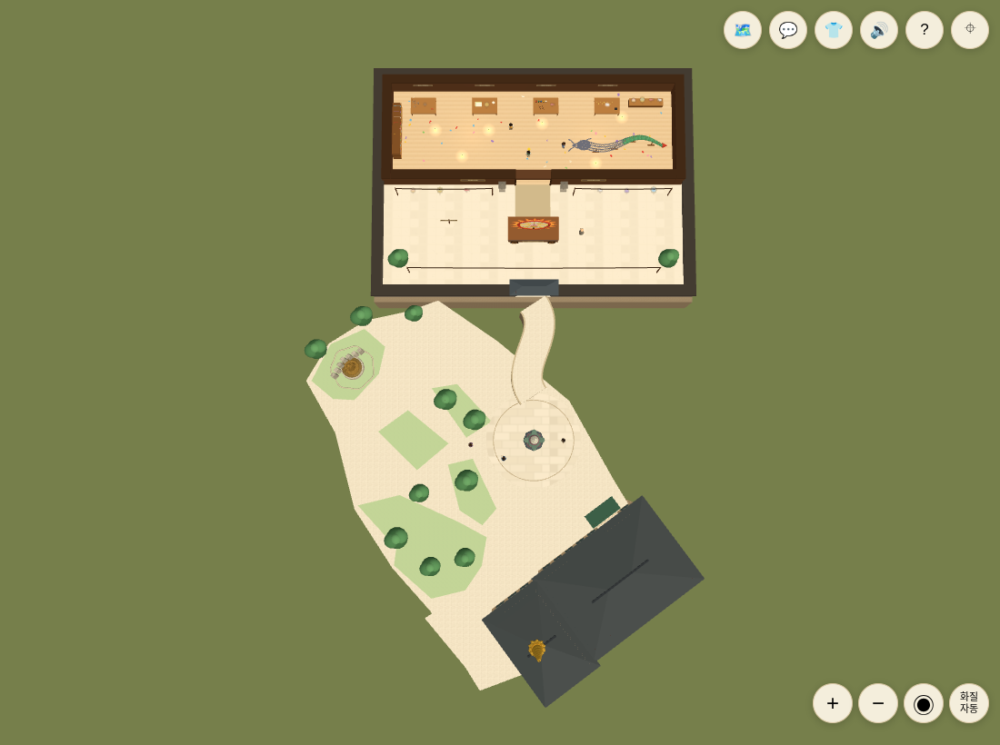
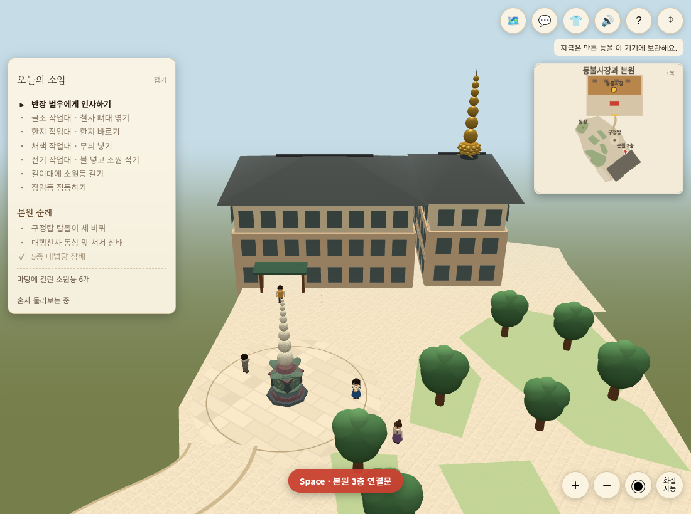
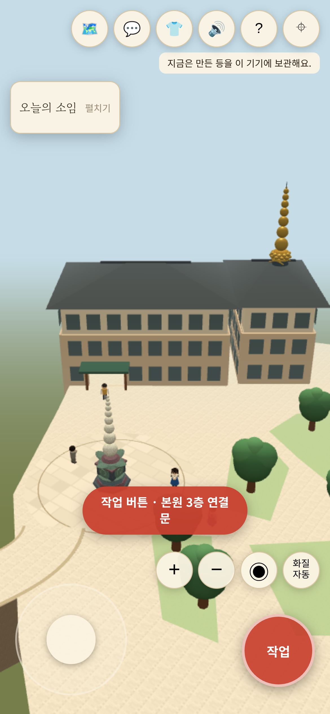

# 도량 외곽·곡선길·본원 3층 연결

기준 main은 PR #35 병합 커밋 `1ca9f4d214a2dce9f992970775098aeaf5c8dcac`이다. 사용자와 스케치·단면도를 순서대로 확인하고 ‘진행해’ 승인을 받은 변경이다.

## 적용 내용

- 구정탑 원형 타일 마당 전체를 포함하도록 도량 오른쪽 외곽만 사선 흐름으로 넓혔다. 왼쪽 외곽·내부 녹지와 작업장·동상·구정탑·본원 두 날개·문·칠보탑의 평면 좌표/방향은 보존했다.
- 작업장 연결길은 문과 원형 마당 끝점을 유지한 S 곡선이다. 도량 타일과 같은 재질로 그리며 길 위 장식 기둥/가로 등줄을 제거했다.
- 구정탑에서 본원까지의 별도 길, 도착 원, 바닥 화살표, 법당 입구 부유 이름표·방향 보기 버튼은 없앴다. 실제 문틀·차양 및 가까이서 실행하는 출입 동작은 남는다.
- 작업장·도량·캐릭터 보행면은 y=0으로 보존하고 본원 1·2층을 그 아래에 놓았다. 게임용 층고 2.2, 1층 -4.4 / 2층 -2.2 / 3층 0 / 4층 2.2 / 5층 4.4다. 평면 배치 변경이나 실제 실측 치수가 아니다.
- 본원 외벽의 3층 문 부분을 실제로 비워 입구 로비까지 걸어 들어간다. 정밀/기본 창호도 문을 덮지 않는다. 문간 슬래브는 타일 마감 아래에 두어 겹침을 피한다. 5층 대법당은 기존 페이지를 사용한다. 내부 계단·엘리베이터·3층 전체 실내 복원은 범위 밖이다.
- 지붕 위 칠보탑은 기존 평면 위치에서 지붕 높이에 맞춰 놓는다. 법당 가까이에서는 입구·플레이어·칠보탑 정상을 함께 담는 시점으로 자동 전환한다. 수동 회전/확대 후에는 외곽 이탈·재진입 전까지 자동 덮어쓰기를 막는다. 전체 보기/모습 선택/의식이 우선한다.
- 보행 방향은 자동 시점 진입·이탈 중에도 렌더된 카메라를 따른다. 손으로 끌 때 자동 시점의 기존 방향에서 이어져야 한다.

## 검증 기록

- 최종 `node --test tests/*.test.mjs`: **83개 통과, 실패 0**. 곡선 중앙 보행·원형 마당 전체 포함·옹벽 밖 보행 차단·탑돌이 여유 폭·출구에서 동상/문까지 도달 가능·실제 3층 벽 개구부·정밀 창호·문간 슬래브·자동 시점 경계/수동 우선·가로세로 투영 검사를 포함한다.
- `npm run build`와 `git diff --check` 통과. 기존 Three.js 청크 752.54kB 경고는 남는다.
- PC Chromium 1100×820 / 모바일 모형 Chromium 390×844, DPR3: 시작/모습 선택, 전체 보기, 법당 근처 자동 시점, 확대 버튼으로 수동 복귀, 외곽 이탈·재진입 후 자동 재개 확인. 칠보탑 정상의 정규화 화면 좌표는 PC (0.381,0.740), 모바일 (0.740,0.495)로 화면 안이다.
- 두 화면에서 W키로 실제 3층 문을 걸어 통과했다. 입구 (33.3512,49.3722)에서 내부 약 (35.14,51.79)까지 이동하고 출입 동작으로 기존 대법당에 들어간 뒤 Space로 도량 입구에 복귀했다. 페이지 실행 오류 0건. 법당 캔버스 CSS 크기는 각 창과 동일했다.
- 최종 문구는 ‘본원 3층 연결문’으로 표시하고 자동 시점에서는 구정탑 이름표가 입구 위를 덮지 않게 숨긴다. 문구 변경 후 PC/모바일에서 다시 실행해 오류 0건 확인했다.
- 별도 검토자가 찾은 수동 드래그의 잘못된 방향 기준을 실제 브라우저에서 재현했다(8px 드래그에 약 2.457rad 회전). 수정 후 약 0.046rad로 이어지며, 자동 구역을 벗어나 계속 S키를 누른 뒤에도 바깥 방향 이동이 0.430칸 더 이어졌다. 방향 반전이 없었다.
- 옹벽 바깥의 예전 충돌 여유와 문간 타일/슬래브 겹침도 실패 테스트를 먼저 확인한 뒤 수정했다. 옹벽 윗면과 타일의 겹침, 곡선길 끝 덧붙임 면의 겹침을 제거하고 실행 화면으로 확인했다.

아래는 생성 스케치가 아니라 이번 소스의 실제 브라우저 화면이다.

## 제한

실제 아이폰 Safari/GPU·발열·메모리, 운영 DB 소원등/방명록 쓰기, 다중 접속 실부하는 검증하지 않는다. 임시 로컬 모드에서 확인하며 운영 설정은 넣지 않는다. 새로운 서버/DB 작업이나 운영 배포·병합은 포함하지 않는다. 기존 Three.js 500kB 초과 청크 경고가 남는다.
