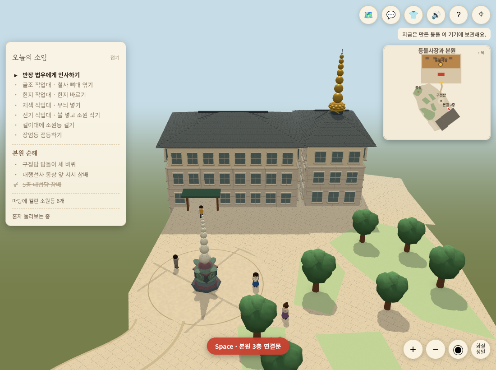
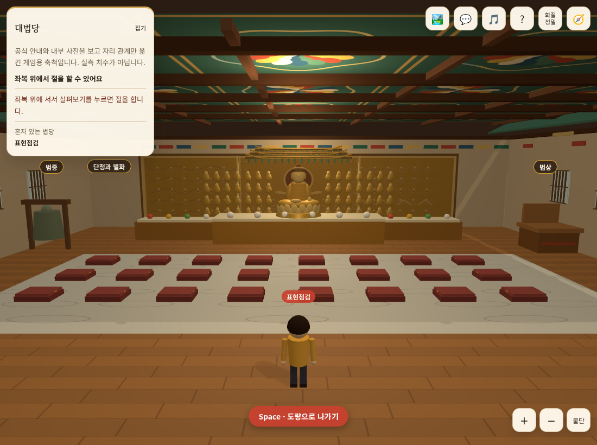
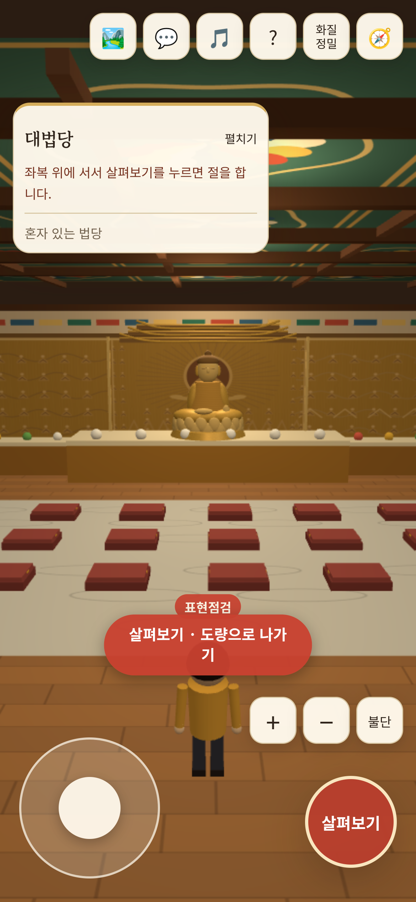

# 담장 제외 · 법당 층고와 내외부 표현 개선

기준 main `211101c`(PR #36 병합). 사용자가 내부 층고 비교·외부 표현 스케치를 승인하고 담장을 제외한 구현을 요청했다.

## 변경

- 실내 천장 4.6→6.0, 상부 벽 3.6→5.0 게임 단위. 상부 보·창과 가림 기준을 같이 맞췄다. 불상·닫집·공양상·사람·좌복 크기와 평면 위치는 보존했다. 카메라 상한 4.05를 유지한다.
- 높은 천장에 보 격자를 더하고 기존 3개 실내 조명과 주변광을 조정했다. 천장 가까이서 하얗게 번지는 빛을 줄였다. 앞벽은 카메라가 바깥에 있을 때 반투명 띠 대신 완전히 걷는다.
- 외부 창틀은 유리보다 앞으로 나와 깊이가 읽히며, 기본 창과 PC 창살은 동일한 칸을 사용한다. 실제 3층 문 개구부는 비운다. 예전 5층의 별도 격자창/붉은 기둥 중복 면을 제거했다.
- 작은 직접 생성 텍스처로 석재 줄눈·기와 결·타일과 목재의 표면 차이를 보강했다. 색상과 요철 텍스처는 분리한다. 유리·금속·돌·목재 거칠기를 구분했다.
- 정밀 화질은 기존 지붕 크기 안에서 네 경사면에 기와 인스턴스를 더한다. 모바일 경량 정책은 유지한다. 기본 창틀과 접촉 그림자는 경량에서도 남는다. 잎은 기존 면 수 안에서 윤곽과 색을 변화시켰다.
- 도량 담장은 추가하지 않았다. 배치·곡선길·3층 연결·칠보탑 위치·출입 충돌·자동 시점·DB/통신·독서 홈페이지는 바꾸지 않았다. 새 라이브러리·원격 사진·조명 개수·후처리 패스 추가 없음.

## 검증

- 최종 `node --test tests/*.test.mjs`: **91개 통과, 실패 0**. 천장 실제 geometry 높이, 상부 벽 연결, 새 가림 기준, 앞벽 가시성, 가로/세로 투영, 유리와 창틀 깊이, 3층 개구부, 지붕 장식 외곽/끝 경사면, 접촉 그림자 알파 및 잎 크기 검사를 포함한다.
- `npm run build`, `git diff --check` 통과. 기존 Three.js 752.53kB 청크 경고가 남는다.
- 소프트웨어 WebGL Chromium PC 1100×820 / 모바일 모형 390×844, DPR3에서 자동 법당 시점·전체 보기·법당 입장·삼배 시작/중단·도량 복귀를 확인했다. 페이지 실행 오류 0건. 입구 (33.3512,49.3722)로 복귀했다.
- PC 장치 힌트(8코어/8GB)를 지정한 정밀 모형에서는 기와/정밀 창살을 확인했다. 같은 힌트여도 모바일 coarse pointer는 가벼운 표현을 유지했다. 이는 실제 GPU 성능/메모리 측정이 아니다.
- 최종 기와 끝면 보완 뒤 PC 정밀 화면을 다시 실행·촬영했고 페이지 오류 0건을 확인했다. 모바일은 해당 기와 그룹을 그리지 않는다.
- 별도 검토자가 확인한 5층 격자 중복은 제거했고, 잎의 면 수 증가는 이전 수준으로 되돌렸다. 앞벽 시야와 기와 끝면 누락은 실패 테스트를 먼저 재현한 뒤 수정했다.

아래는 생성 스케치가 아닌 실제 소스 실행 화면이다.

## 한계

게임용 비율·직접 만든 표현이며 실물 치수, 사진 정합, 정밀 스캔 모델을 뜻하지 않는다. 실제 아이폰 Safari/GPU·발열·배터리·운영 DB 쓰기·다중 접속 부하는 검증하지 않았다. 기존 삼배의 전체 완료까지 이번 브라우저 검사에서 기다리지는 않았으며 시작/중단을 확인했다. 운영 설정을 넣지 않은 로컬 모드이고 병합/운영 배포는 하지 않는다. PR 본문은 기존 사용자 지시대로 “검증 못 했음”만 쓴다.
