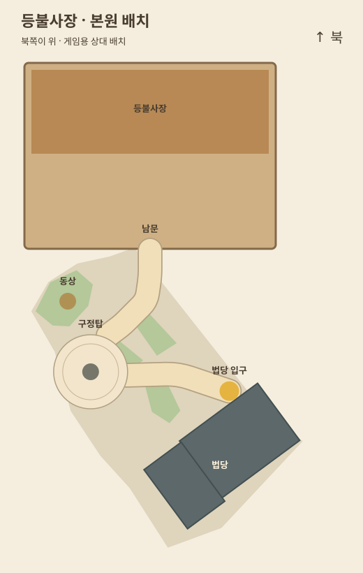
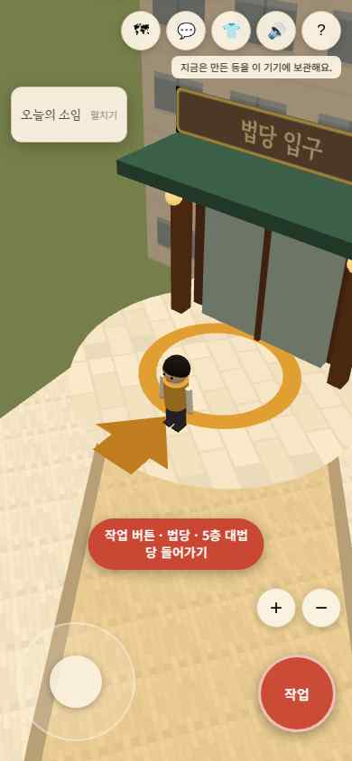

> **이전 안입니다.** 구정탑을 옮긴 이 배치는 사용자 정정으로 폐기됐습니다. 현재 기준은 [승인 스케치 적용 보고서](APPROVED_LAYOUT_REVIEW_2026-11-10.md)입니다.

# 작업장 북동쪽 상대 배치와 법당 길 찾기

기준 main: `e3f5f44af136d6f26a22dcdaca7725991c961d72`. 기존 전면 점검 PR #31은 이미 병합돼 있다.

사용자 요청은 작업장을 구정탑의 북동쪽에 충분히 떨어져 배치하고 자연스럽게 연결하며, 법당 입구를 쉽게 찾고 구정탑과 법당 사이를 넓히는 것이다.

## 배치

기능과 소품이 많은 원본 작업장은 그대로 두고, **구정탑의 상대 위치를 서쪽 17칸·남쪽 2칸 조정**했다. 그 결과 작업장 중심과 남문은 탑의 북동쪽에 있다. 본관·동상·칠보탑의 기준은 유지한다. 이는 최신 요청에 따른 게임 배치 변경이며, 실제 위성사진 좌표 복원이라고 설명하지 않는다.

- 구정탑: (9.4803,44.2034)
- 작업장 남문: (18,26), 중심: (18,13.3)
- 남문→탑 중심: 약 20.1칸
- 탑 앞마당 가장자리→법당 외곽의 최단 여유: 약 10.5칸
- 탑돌이 반지름 4와 양옆 .6칸 여유 유지

수치는 게임 좌표이며 실제 m가 아니다. 북쪽이 위인 좌표계다.

## 연결과 입구

작업장 남문에서 굽은 돌길을 내려오면 탑 앞마당에 닿고, 다른 밝은 돌길이 법당 문 앞의 둥근 공간으로 이어진다. 경로와 나무 제외·충돌 판정은 같은 데이터를 사용한다. 길 표면은 하나의 다각형으로 그려 굽은 구간마다 별도 메쉬를 많이 늘리지 않는다.

법당 문은 차양·문틀·등·큰 “법당 입구” 간판, 금색 문턱과 바닥 화살표로 구분한다. 미니맵도 건물 중심 대신 실제 문을 표시한다. 입구 작업 반경은 1.9→2.8칸으로 넓혔다.

바깥 마당의 “법당 입구 방향 보기”를 누르면 카메라만 문 쪽으로 돌아간다. 자동 이동·순간이동은 없다. 문 앞의 작업 버튼과 기존 대법당 연결은 그대로 사용한다.

## 검증

- npm run build 성공. 기존 Three.js 번들 크기 경고는 남는다.
- node --test **81개 통과**.
- 작업장→탑/동상/법당의 격자 경로 탐색, 돌길 중앙의 연속 보행, 탑돌이 전 구간과 여유 폭 검사 통과.
- 작업장의 북동쪽 관계, 문과 탑의 거리, 탑 앞마당과 법당 간격, 안내 NPC가 길/탑돌이를 막지 않는 회귀 검사 추가.
- Chromium 데스크톱 및 390×844 터치 화면에서 입구 안내 버튼, 새 입구 형태, 작업 메뉴와 실제 기존 대법당 URL 이동 확인. pageerror 0.
- git diff --check 통과.
- 기존 등 제작·저장·공유·캐릭터·법당 내부와 실시간 서버 설정은 유지한다. 독서 홈페이지는 수정하지 않았다.
- 운영 DB 쓰기·실기기 성능·80명 부하를 이번 배치 검증에 포함하지 않았다. PR 본문은 사용자 요청대로 “검증 못 했음” 한 줄이다.
