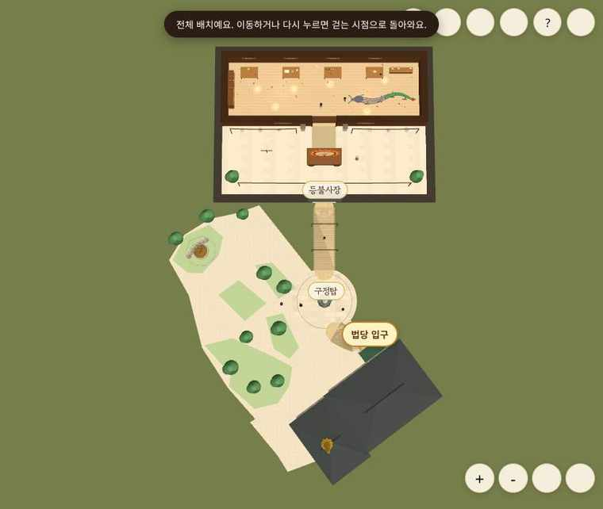

# 등불사장만 구정탑 북쪽으로 이동

기준 main: 976c80f3e025ae824ea1b4e232d5358c026a2ac5. 사용자가 승인한 마지막 스케치에 맞춰 등불사장만 이동한다. 이전 북동쪽 배치안은 이번 요청으로 대체한다.

## 최종 배치

- 구정탑·동상·법당 두 날개·칠보탑·법당 문·법당 연결길·동상 방향/참배 자리는 기준 main과 값이 동일하다. 이전 모듈을 별도로 불러 각 배열·좌표·방향을 비교했다.
- 등불사장 내부는 36×26.6 게임 칸 그대로다. 전체를 서쪽으로 평행 이동해 남문 중심 x를 구정탑 중심 x=26.4803에 맞췄다. WORKSHOP_OFFSET=(8.4803,0).
- 남문 (26.4803,26)에서 앞마당 북쪽 가장자리로 직선길이 이어진다. 연결길 중심선은 약 29.27→10.45칸으로 약 64% 줄었다. 이는 게임 좌표 계산이며 실측 거리나 보행 시간은 아니다.
- 작업장 남쪽 경계와 탑의 원형 앞마당 사이에는 약 10.30칸 여유가 있다. 탑돌이 반지름4와 양옆 .6 여유는 유지한다. 원형 마당을 가로지르는 지름길을 만들지 않았다.
- 기존 로컬/세계 좌표 변환을 재사용하므로 작업대·NPC·소원등 걸이대·장엄등·플레이어 시작점이 작업장과 함께 이동한다. 내부 소품·캐릭터·기능을 축소하거나 새 장면으로 나누지 않았다.
- 작업장 판정의 고정 x36~72를 제거하고 workshopLocal로 검사한다. 새 연결길 장식은 꼭짓점 번호 대신 길의 30%/70% 지점에 배치한다. 작업장·새 길과 겹치는 외부 나무는 제외한다.
- 미니맵·전체 보기 시점은 실제 배치 외곽 SCENE_VIEW를 같이 사용한다.

## 실제 실행 화면

생성 스케치가 아니라 이번 소스의 브라우저 실행 기록이다.

## 검증

- 테스트 88개 통과: 북쪽 남문 정렬·길 길이·탑돌이 720개 방향의 여유 폭·출구에서 동상/법당까지 도달 가능 여부·법당 길·장식 기둥 충돌을 확인했다.
- PC Chromium 900×760: 시작점이 옮긴 작업장 안에 있음, 남문 안쪽에서 S키로 실제 걸어 나감(z25.35→29.15), 직선 연결길·전체 보기 확인. pageerror 0.
- 모바일 모형 Chromium 390×844: 옮긴 골조 작업대에서 제작 모양 선택 창 열기, 반장 NPC 대화 안내, 기존 법당 입장, 법당 앞 기존 좌표로 복귀 확인. pageerror 0.
- 임시 환경은 운영 Supabase 설정을 넣지 않은 로컬 모드다. 운영 DB 쓰기·실제 휴대전화 GPU·80명 동시접속 부하는 시험하지 않았다.
- 최종 npm ci·npm run build·git diff --check 통과, npm audit 취약점 0건. 기존 Three.js 500kB 초과 번들 경고는 남아 있다.

기존 사실감 개선·화질 선택·카메라·BGM은 보존한다. 독서 홈페이지·실시간 서버 설정은 변경하지 않았다. 병합과 운영 배포는 클로드에서 진행한다는 사용자 지시에 따라 PR만 올린다. PR 본문은 요청대로 “검증 못 했음”을 유지한다.
