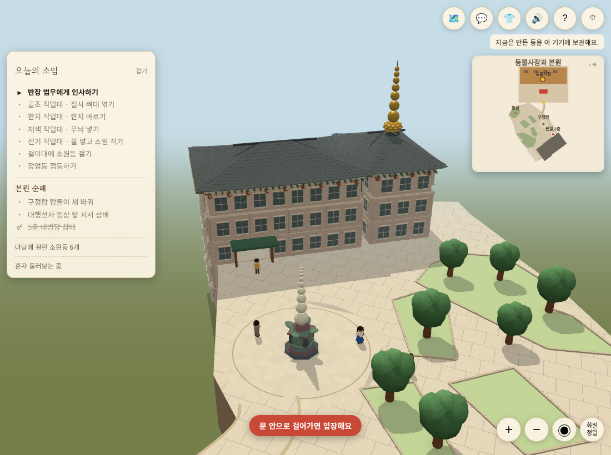
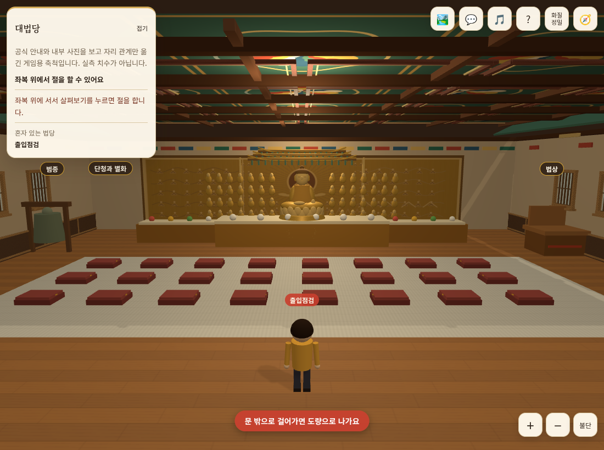

# 사진 기반 내외부 표현·걸어서 퇴장 — 2026-11-11

## 적용 범위

PR #38에 후속 변경을 추가했다. 최신 main d45bc91의 구정탑을 비켜 보는 자동 시점과 폐기된 입구 안내 제거를 병합해 유지한다. 건물·탑·동상·작업장 위치와 방향, 도량 외곽·길, 3층 연결·내부 천장고6·사람/불상/좌복·절하기는 유지한다. 담장·새 조명·라이브러리·운영 DB 변경은 없다.

### 걸어서 나가기

- 기존 입장 판정 createWalkInDoor를 내부 출구 좌표에 재사용한다. 출구 중심 x13, 문칸 z19, 바깥쪽 문턱 z19.35와 폭±1.7 안에서 실제로 걸어 넘으면 기존 도량 복귀 경로로 이동한다.
- 입장 위치(13,18.2)에 정지한 채로 서 있어도 나가지 않는다. 문 옆 이동·안쪽 이동·순간이동·대화/절하기 중 이동을 제외한다. 퇴장 후 바깥에서도 정지만으로 재입장하지 않는다.
- 기존 돌아가기 버튼과 출구 근처 Space/살펴보기 대체 경로는 유지한다. BFCache 복귀 시 문턱 판정과 키·조이스틱을 초기화한다.
- 내부 출구를 가로막던 닫힌 면을 양쪽 문틀·위 인방으로 교체했다. 벽과 함께 가려지며 바닥 문칸과 보행 폭을 비운다.

### 사진 기반 외부 표현

실제 원본 one_about_01.jpg와 one_status_02.jpg를 보고 본원 외벽의 차분한 분홍빛 석재·어두운 창, 기와지붕과 반복 처마 구조, 밝은 큰 도량 포장과 잔디 가장자리의 낮은 턱을 확인했다. 출입구 준공 행사 사진 one_status_01.jpg는 과거 자료로 구분한다. 공식 출처는 `HANMAUM_EXTERIOR_SOURCES_2026-11-11.json`에 기록했다.

- 외벽과 창틀·유리의 색/깊이 차이, 도량의 큰 회백색 타일·낮은 화단 석재 경계를 보강했다. 화단 경계는 기존 녹지 다각형을 그대로 따라가며 0.11 게임 단위 높이의 장식이다. 도량 외곽 담장이 아니고 새 충돌을 추가하지 않는다.
- 평면 삼각형 지붕을 기존 처마 외곽·용마루 높이 안의 휘어진 면으로 바꾸고 UV를 추가해 가벼운 화질에서도 직접 만든 기와 결이 보이게 했다. 기존 정밀 기와는 같은 곡면 높이를 따른다.
- 정밀 서까래/공포/끝 장식은 인스턴스화해 화질 그룹과 건물 가림에 등록했다. 모바일 가벼운 화질에서는 반복 장식을 숨긴다.

### 사진 기반 내부 표현

기존 수집 원본 0201·0202·0203·0501을 대조한 실내 마감이다. 목재 하부 벽, 창틀과 창턱, 천장의 겹 테두리, 마루 나뭇결·밝은 깔개 직조 결을 추가했다. 새 벽 장식은 각 벽의 onWall, 천장 테두리는 ceilParts에 등록해 카메라가 밖으로 나갈 때 함께 걷힌다. 장식이 허공에 남지 않는다.

사진 원본을 앱 텍스처로 넣지 않았다. 불상/목탱화 세부 조각·실내 계단 전체·정밀 실측 복원이 아니며, 사진의 모든 물건이나 행사 장식을 재현했다고 표현하지 않는다.

## 검증

- 신규 출구 테스트는 기능 누락 상태에서 실패를 확인한 뒤 실제 문칸 내 이동, 입장 직후 정지, 옆 통과·역방향·순간이동·disabled·reset 조건으로 통과했다.
- 지붕 UV/곡면 테스트도 먼저 실패를 확인한 뒤 통과했다. 기존 기와 외곽·단부 경사면, 3층 문 개구부·창틀 깊이, 카메라·배치 테스트를 포함해 전체 102개 통과.
- npm run build 통과. 기존 Three.js 청크 500kB 초과 경고 유지. git diff --check 통과.
- 독립 코드 리뷰: 수정이 필요한 critical/important/minor 문제 없음. 출구 도달성·복귀/정지·BFCache·장식 가림·문 개구부·지붕·모바일 화질 정책을 검토했다.
- 실제 아이폰 Safari/GPU, 운영 DB 쓰기·다중 접속·운영 배포는 검증하지 않았다. 병합/운영 배포는 클로드가 진행한다.

## 실행 화면

브라우저에서 직접 촬영한 구현 화면이다. 생성 스케치나 사진 일치 모델이 아니다.

브라우저 검증: Chromium PC 1100×820(정밀 화질) / 모바일 에뮬레이션 390×844·DPR3·coarse touch(가벼운 화질)에서 모두 통과했다. 실제 W/S 키와 CDP 터치 조이스틱으로 문턱을 건너 입장·퇴장, 입장 직후 2초 정지·복귀 후 2초 정지 유지, 좌복에서 삼배 시작/멈추기, 순간이동 후 정지 유지, 페이지 오류 0건을 확인했다. 좌복 배치에만 개발용 warp를 쓰고 출입은 실제 걷기로 검증했다. 처음 PC 테스트는 숨겨진 모바일 전용 살펴보기 버튼을 클릭하려다 멈춰 PC 입력을 Space로 고쳤으며, 최종 PC/모바일 동선은 모두 통과했다. 개발 환경의 불필요한 정적 리소스 404 로그는 페이지 스크립트 오류와 구분한다.
