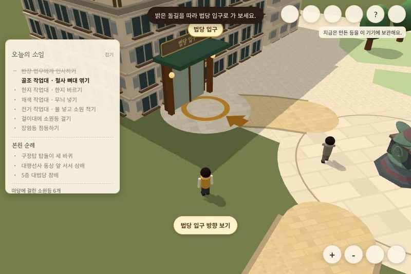
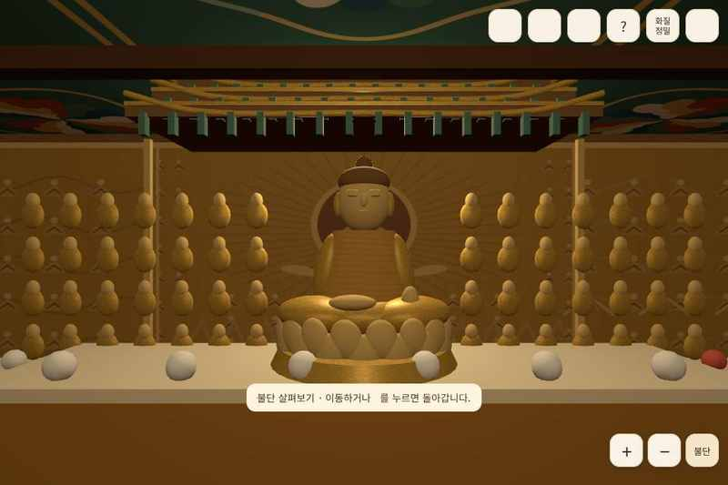

# 공식 사진 대조와 PC 표현 개선

main에 병합된 PR #33의 승인 배치 위에 추가한 첫 번째 시각 개선이다. 검증 기준은 PR #33의 2b9e30f와 같은 트리를 가진 main af8a286이다. 게시 직전 최신 main cbedd672의 작업장 울타리 길이 수정도 보존했다. 마지막 울타리 병합 뒤에는 실행 검증을 다시 하지 않았다. 구정탑·동상 좌표, 법당 평행 이동, 작업장 위치·보행 판정은 변경하지 않았다. 실사 스캔 모델이나 실측 복원은 아니다.

## 이번에 실제 확인한 자료

2026-11-10 공식 페이지의 이미지 원본을 임시 검증 환경으로 받아 축소본의 픽셀을 직접 확인했다. 이전 문서의 “이미지 placeholder만 확인”은 과거 작업 당시의 한계다. 이번에는 정면·측면 특징을 대조했다. 공식 사진 파일은 저장소나 배포 텍스처에 포함하지 않는다.

- [조감도](https://hanmaum.org/Content/img/one/one_tour_01.jpg): 직각으로 연결된 긴 본원 외관, 층별 창호와 상부 기와지붕.
- [대법당 전경](https://hanmaum.org/Content/img/one/one_tour_0201.jpg), [닫집](https://hanmaum.org/Content/img/one/one_tour_0202.jpg), [불단 정면](https://hanmaum.org/Content/img/one/one_tour_0203.jpg): 금빛 후불 목탱화·본존불·중층 닫집, 천장 격자와 단청.
- [구정탑](https://hanmaum.org/Content/img/one/one_tour_0701.jpg), [기단 근경](https://hanmaum.org/Content/img/one/one_tour_0702.jpg): 아홉 구와 높은 사각 받침, 위로 들린 연잎과 유색 석재.
- [대행선사 동상](https://hanmaum.org/Content/img/one/one_tour_0801.jpg), [측면](https://hanmaum.org/Content/img/one/one_tour_0802.jpg): 한 손에 세운 지팡이·긴 법의·연화좌대·뒤쪽 화엄석.
- [칠보탑](https://hanmaum.org/Content/img/one/one_tour_0601.jpg): 기존 일곱 금빛 구 모델과 큰 구성을 대조했다. 이번에 새 정밀 용 조각 모델을 만든 것은 아니다.

## 구현

- 본원: 승인된 두 직사각형 안에서 창유리·창틀·층별 띠·창살을 인스턴스로 추가했다. 지붕에 직접 생성한 기와 결 재질을 적용했다. 창문 간격·외관 높이는 시각 추정이며 실제 치수와 일치한다는 보장은 없다.
- 구정탑: 아홉 구를 유지하고 받침 비중을 키웠다. 사각 석재·연잎·곡선 부조와 석재 표면을 보강했다. 각 구의 실측 지름은 확보하지 못했으므로 기존 추정 지름 비율은 유지했다.
- 동상: 빠져 있던 지팡이, 이를 쥔 팔과 손, 반대쪽 소매, 옷 주름·눈·입을 추가했다. 청동 재질과 화엄석을 보강했다. 얼굴의 실제 닮음과 손가락 세부는 아직 단순화 모델이다.
- 법당: 금빛 목탱화, 배면 군상 부조, 중층 처마와 공포, 반복 연화문·천장 격자를 보강했다. 개별 인물·용 조각을 정확하게 복원한 모델은 아니다.
- 시점: 외부의 ◉는 낮은 탐방 시점이며 +/− 확대·축소가 유지된다. 카메라를 가리는 본원은 낮은 시점에서 걷어낸다. 법당에는 ‘불단’ 가까이 보기 버튼을 추가했다. 캐릭터를 옮기지 않으며 이동·직접 시점 조작·🧭로 돌아간다. 감상 중에는 문 앞 행동 안내·이름표·소임 HUD를 감춰 혼동을 줄인다.
- 화질: 공용 `sceneQuality.js` 정책과 `realismMaterials.js` 제어기로 자동/정밀/가볍게를 선택한다. 모바일·메모리 4GB 미만·4코어 미만·데이터 절약 기기는 정밀 선택에서도 가벼운 표현을 유지한다. 상세 부조/창호·그림자·픽셀 배율만 줄이며 위치·캐릭터·통신 기능은 바꾸지 않는다. 자동은 연속으로 느린 프레임이 쌓이면 한 번 낮춰 반복 전환을 방지한다.
- 재질은 128×128 DataTexture를 직접 생성해 재사용한다. 새 런타임 의존성·외부 이미지 요청·후처리 패스·장식별 조명은 추가하지 않았다.

## 실제 실행 화면

아래는 생성 시안 이미지가 아니라 이번 소스의 브라우저 실행 기록이다.

## 검증과 한계

검증 환경은 운영 설정과 분리한 임시 Vercel Sandbox와 소프트웨어 WebGL Chromium이다. 화면 크기/기기 힌트 변경은 실제 PC GPU나 휴대전화 실측을 뜻하지 않는다.

- 테스트 88개 통과. 승인 좌표·문/동상/작업장 길·탑돌이 공간 회귀 검사는 기존 시험에 포함된다. 새 시험은 저사양 정책 및 연속 지연 시 한 번만 품질을 낮추는 동작을 확인했다.
- 새로 npm ci 실행 후 빌드 성공. 의존성 보안 검사 취약점 0건, git diff --check 통과.
- 빌드 성공. 기존 Three.js 752.53kB 청크 경고는 남아 있다.
- 실제 브라우저에서 PC 정밀 표현, 전체 보기, 낮은 탐방 시점, 법당 진입·불단 시점과 이동 복귀를 확인했다. 모바일은 320×740에서 버튼 범위와 가벼운 품질 유지, 페이지 간 화질 설정 보존을 확인한다.
- 실물 치수 측정, 3D 스캔, 정밀 얼굴/손/용 조각, 실제 GPU FPS·발열·메모리, 실제 80명 부하·운영 DB 쓰기 검증은 하지 않았다.
- 현 단계는 사진에서 보이는 특징을 반영한 스타일화 3D 개선이다. 사진 같은 최종 품질에는 정밀 모델(GLB) 제작과 여러 방향의 기준 사진 대조가 추가로 필요하다.

이전 PR #33의 기능·배치 검증 기록은 [승인 배치 점검](APPROVED_LAYOUT_REVIEW_2026-11-10.md)에 있다. PR 본문은 사용자 요청대로 “검증 못 했음”을 유지한다.
