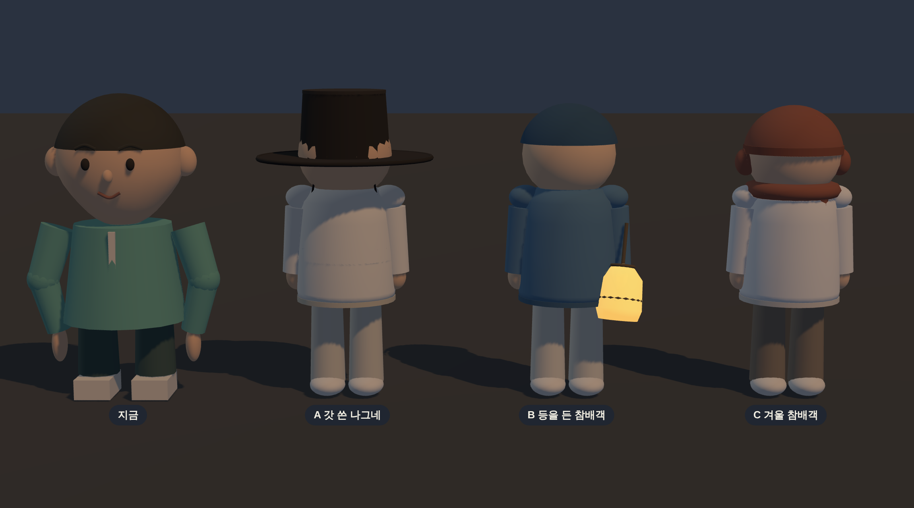
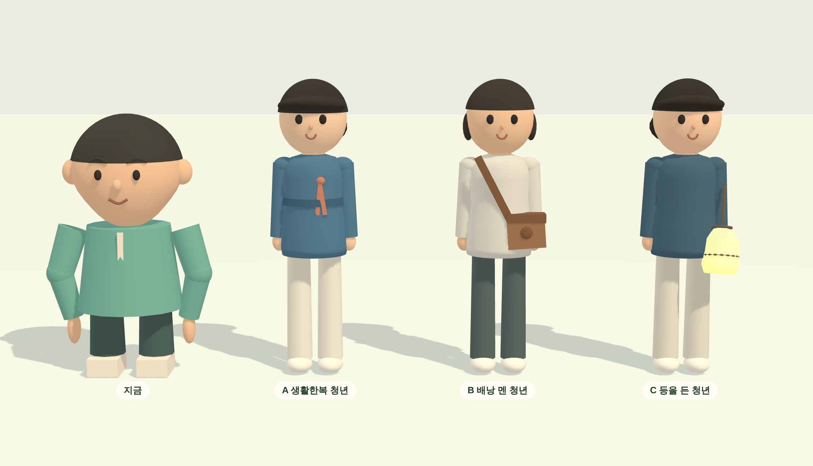
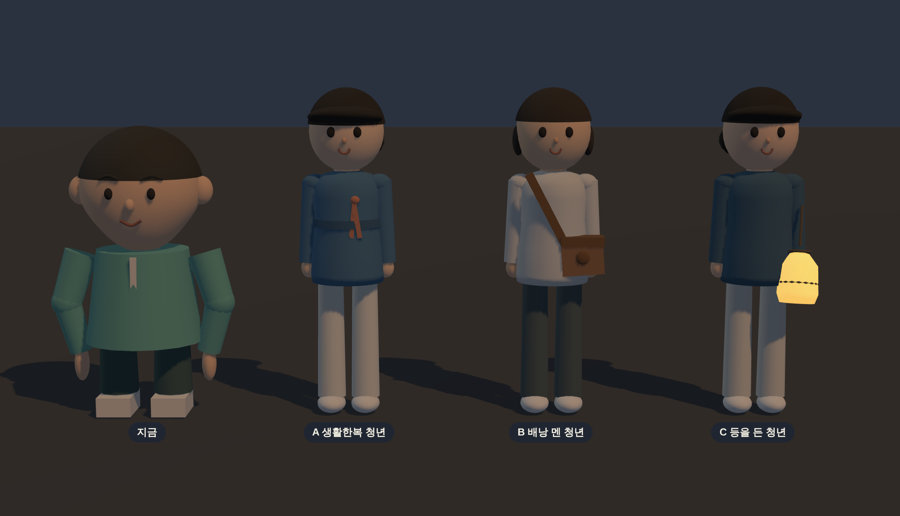

# v8 개선 기획안 — sansatemple 벤치마킹 (2026-11-14)

사용자 요청: *"벤치마킹하고 싶으니까 v8 개선안 보고해봐 (캐릭터만 말고, 전체적으로). 동자승은 하지말고 다른걸로."*
기준 분석은 `docs/SANSA_REFERENCE_2026-11-14.md`. **아직 코드는 고치지 않았습니다.**

## 1. 숫자로 본 차이

세어 봤습니다.

| | v8 | sansatemple |
| --- | --- | --- |
| 장면 | **9** | 1 (방만 여러 개) |
| 활동 | **38** | **4** (합장·절하기·목탁·염주) |
| 화면에 얹힌 UI 덩어리 | **54** | 약 10 |
| 분위기 | 계절 4 × 시간 4 + 날씨 = **16+** | **해질녘 하나** |
| 메뉴 | 하단 5 + `이곳의 활동` + 모바일 시트 | **없음** |

**같은 장르인데 표면적이 열 배입니다.** 저쪽이 이긴 방식은 더하기가 아니라 빼기였습니다.
이 기획안의 대부분도 더하는 게 아니라 **덜어내는 것**입니다.

## 2. 개선 ① — 화면을 덜어낸다 (가장 큼)

지금 상시 요소 54개가 네 군데로 흩어져 있습니다. 레벨·경험치는 프로필 카드에, 마음잎은
별도 알약에, 일지는 하단 네비에, 소지품은 또 하단 네비에.

- **상시로 남길 것 넷**: 장소 이름 / 지금 할 일 하나 / 대화 / 아래 단추 줄.
- **프로필 하나로 합칠 것**: 레벨·경험치·마음잎·일지·배낭. 하단 네비 5 → 2 (지도·나).
- **`이곳의 활동` 목록을 없앤다.** 걸어가서 그 앞에서 작업 단추를 누르는 길이 이미 있습니다.
  목록은 그 길을 건너뛰는 지름길이라, 걸어 다닐 이유를 스스로 없애고 있었습니다.
  (대신 길 안내는 남깁니다 — `등불사장에 가 볼까요?` 같은 한 줄.)
- 모바일은 이미 `m-simple` 로 한 번 줄였습니다. PC 도 같은 수준으로 내립니다.

## 3. 개선 ② — 화면에 밝은 점을 하나 만든다

저쪽 화면에서 가장 밝은 곳은 **법당 문 안의 금빛 하나**뿐입니다. 눈이 거기로 갑니다.
v8 은 전체가 고르게 밝아서 어디를 보라는 건지 없습니다.

- 전체 밝기를 **한 단계 낮추고**, 밝은 점을 두 곳만 남깁니다:
  **① 손에 든 등 ② 전시벽의 걸린 등.**
- 이러면 ①의 캐릭터 안(아래 B)과 바로 이어집니다. 밤에 사람이 모이면 마당이 등불로 찹니다.
  **게임 제목이 그것입니다.**

## 4. 개선 ③ — 분위기를 하나로 깊게

계절 4 × 시간 4 = 16가지를 다 돌보느라 어느 하나도 깊지 않습니다.
사용자가 전에 *"계절 색은 1년 동안 접속해야 확인하는 거냐"* 고 한 지적과 같은 선입니다.

- **해질녘 하나**를 기본으로 정하고 거기만 제대로 만듭니다(하늘 두 단, 안개 낀 먼 산,
  긴 그림자, 따뜻한 역광). 나머지 시간대는 남겨 두되 공들이지 않습니다.
- 쓰는 색을 줄입니다. 저쪽은 갈색·회색·남색 + 겨자 하나입니다.

## 5. 개선 ④ — 캐릭터 (동자승 말고)

기준에서 뽑은 다섯 규칙만 가져오고, 복식은 다른 것으로 합니다.

1. **머리카락을 만들지 않는다**(덮개로 해결) — 바가지 머리가 지금까지 가장 큰 문제였습니다
2. **큰 색면 두 개** — 멀리서 읽히는 건 가는 선이 아니라 면입니다
3. **목이 없다** — 머리가 어깨에 바로 얹힙니다
4. **약 3.2~3.4등신**, 모서리 전부 둥금
5. **완전 무광**, 테두리·무늬·질감 없음

| | 무엇 | 왜 |
| --- | --- | --- |
| **A 갓 쓴 나그네** | 검은 갓 + 미색 두루마기 + 남색 띠 | 카메라가 내려다보므로 **둥근 챙이 화면에서 가장 또렷한 형태**가 됩니다. 한국적이고 헷갈릴 수 없습니다 |
| **B 등을 든 참배객** ★ | 쪽빛 저고리 + 미색 바지 + 두건 + **손에 든 등** | 캐릭터가 곧 화면의 밝은 점입니다. 개선 ②와 한 몸이고, 제목과 같습니다 |
| **C 겨울 참배객** | 흰 솜옷 + 밤색 털모자·목도리 | 포근하지만 셋 중 가장 평범합니다 |

**추천은 B 입니다.** 해질녘 그림에서 눈에 들어오는 것이 그 등 하나입니다.
A 는 실루엣이 가장 셉니다. 둘을 섞어도 됩니다(갓 쓰고 등 들기).

시안 코드는 `docs/concept/character-v2.js`. 마감은 거칩니다.

## 6. 개선 ⑤ — 소리

저쪽은 `염불 듣기` 단추 하나입니다. v8 의 `bgm.js` 는 Web Audio 합성 선율뿐이고
**환경음이 없습니다**(바람·풍경·새·발소리). 환경음 한 겹이 분위기에 가장 싸게 기여합니다.
외부 음원은 받지 않으므로 합성으로 만듭니다.

## 7. 개선 ⑥ — 첫 30초

- 저쪽: 들어가면 **바로 문 앞**. 할 일 네 개가 전부 보임.
- v8: 이름 짓기 → 모습 고르기 → 안내 → 메뉴. **고를 것이 먼저 나옵니다.**
- 바꿀 것: 이름만 받고 바로 들여보낸 뒤, 모습은 걷다가 언제든 고치게 합니다.
  (지금도 `details` 로 접혀 있지만 여전히 시작 화면에 있습니다.)

## 8. 순서와 크기

| | 일 | 건드리는 곳 | 크기 |
| --- | --- | --- | --- |
| 1 | 대화를 상시 패널로 (별도 기획안) | features.js · CSS | 중 |
| 2 | 화면 덜어내기 | app.js HUD · CSS | 중 |
| 3 | 캐릭터 B | avatar-social.js | 중 |
| 4 | 밝은 점 둘 + 전체 밝기 | 조명·전시벽 | 소 |
| 5 | 해질녘 하나로 | environment.js | 소 |
| 6 | 환경음 | bgm.js | 소 |
| 7 | 첫 30초 | app.js 온보딩 | 소 |

## 9. 하지 않는 것

- **저쪽 화면·에셋·코드를 가져오지 않습니다.** 같은 장르·같은 소재라 닮는 부분은
  있어도 모델과 코드는 직접 만듭니다. 저쪽 캡처를 저장소에 넣지 않습니다.
- 장면 아홉을 줄이지 않습니다. 이미 만든 공간입니다. 줄이는 건 **화면에 얹힌 것**입니다.
- 접속 인원 작업을 더 하지 않습니다(relay 80명은 이미 PASS, 병목은 사람 수입니다).

---

# 고쳐 쓴 기획안 — 위 내용은 최선이 아니었습니다

사용자: *"기획안은 이게 최선이야?"* — 아닙니다. 다시 봤더니 네 군데가 틀렸습니다.

## 무엇이 틀렸나

1. **전부 베끼기였습니다.** 여덟 항목 중 일곱이 "sansa 처럼". 빼기만 하면 결국
   **sansa 의 늦은 열화판**이 됩니다. v8 이 sansa 가 **아닌** 무엇인지 한 줄도 없었습니다.
2. **제가 이틀 전에 스스로 내린 진단을 버렸습니다.** `docs/V8_PLAN_2026-11-14.md` 에 제가
   적은 말: *"그릇은 80명인데 사람이 없습니다."* 병목은 꾸밈이 아니라 **아무도 없다는 것**인데,
   그 뒤 사흘을 캐릭터와 HUD 에 썼습니다.
3. **v8 이 가진 것을 안 썼습니다.** 아래 표가 그것입니다.
4. **지금 당장 바뀌는 게 없었습니다.** 화면 덜어내기·해질녘·환경음은 반년 뒤에 해도 됩니다.

## 기준을 바꿉니다

sansa 와 같은 것을 더 잘하려 하지 않습니다. **sansa 가 구조적으로 못 하는 것**을 합니다.

| | sansatemple | v8 |
| --- | --- | --- |
| 한 번 방문 | 3분, 쉬고 나감 | 등 하나에 **5공정** |
| 남는 것 | **없음** | **등이 벽에 남아 남이 지나가며 본다** |
| 다시 올 이유 | 없음 (그게 그 제품의 설계입니다) | 만들 수 있음 |
| 남에게 말할 이유 | 없음 | 내 등을 보여 줄 수 있음 |

> **v8 의 한 줄: 다녀간 사람이 남아 있는 곳.**

저쪽은 '잠깐 쉬어가는 곳'이라 **아무것도 남기지 않는 게 설계**입니다. 거기를 따라가면
우리가 이미 만든 유일한 차별점을 버리게 됩니다.

## 그래서 진짜 할 일

### 1. 혼자 있어도 사람이 있다는 걸 알게 한다  ← 대화 기획을 이걸로 **대체**합니다

앞의 대화 기획안에는 큰 구멍이 있었습니다. **혼자 접속이 기본인 앱에서 실시간 대화 패널은
대부분 빈 상자입니다.** 지금 대화 기록 0 줄, 동시 접속 거의 0 입니다.

- 왼쪽 패널을 `대화창`이 아니라 **`마당 소식`** 으로 만듭니다.
- 담는 것: 실시간 대화 + **방금 걸린 등** + 들어옴/나감 + 누가 절을 올림 +
  마지막으로 다녀간 시각.
- 혼자일 때도 `세 시간 전, 작은 산새가 등을 걸었습니다` 가 떠 있습니다.
- **그래서 비지 않습니다.** 이것이 대화 기획의 핵심 수정입니다.
  (패널 구조·장소 태그·상시 입력·큰 창 제거는 `docs/V8_CHAT_REDESIGN_2026-11-14.md` 그대로.)
- 소식의 재료는 **이미 다 있습니다**: `v8_lantern.created_at`, presence 들고 남, 절 기록.
  새 통신·새 표 없이 **읽어서 줄로 만드는 일**입니다.

### 2. 등이 산다 — 심지와 밝혀 주기

- 건 날부터 이레에 걸쳐 흐려지고, 남이 `밝혀 주기` 를 하면 이틀씩 늘어 서른 날에서 멈춥니다.
- **돌아올 이유**와 **혼자 와도 할 일**(남의 흐려지는 등 밝히기)이 동시에 생깁니다.
- `v8_blessing` 표 하나. v1 쪽에 이미 설계가 있습니다(`lanternLife.js`).

### 3. 등 하나의 주소 — `?lantern=<id>`

- **지금 앱 안에 남을 부르는 수단이 하나도 없습니다.** 필요한 건 80명이 아니라 1명이 1명을
  부르는 길입니다. 발원문은 보여 주고 싶은 글입니다.

### 4. 벤치마킹에서 가져올 것은 둘뿐

- **밝은 점 하나** — 캐릭터 C(등을 든 청년)와 한 몸입니다. 싸고 효과가 큽니다.
- **첫 30초 단축** — 이름만 받고 바로 들여보냅니다.

### 5. 나머지는 1~4 뒤

화면 54개 덜어내기 · 해질녘 하나로 · 환경음 · 활동 정리. 지금 화면이 복잡한 건 사실이지만
**복잡함이 드러날 사람이 없습니다.** 캐릭터 교체는 사용자가 원하니 먼저 할 수 있지만,
그것이 사람을 불러오지는 않습니다. 그 점을 섞지 않고 적어 둡니다.

## 측정 (지금 값을 기준으로)

| | 지금 |
| --- | --- |
| `v8_lantern` | **2줄, 둘 다 제 시험용** |
| 남이 건 등 | 0 |
| 밝혀 주기 | 0 |
| 대화 기록 | 0 |

- 1 뒤: 혼자 들어와도 소식 패널이 비어 있지 않은가
- 2 뒤: **밝혀 주기 1건**
- 3 뒤: `?lantern=` 으로 들어온 접속 1건

셋 다 0 이면 기능이 아니라 **사람을 부르는 쪽**이 문제입니다. 그때는 코드를 더 쓰지 않습니다.

## 캐릭터 — 청년 (사용자 요청)

동자승도 아니고 아이도 아닌 **청년**으로 다시 세웠습니다. 어른으로 읽히게 **약 4등신**,
다리를 길게, 머리를 작게. 큰 색면 두 개와 완전 무광은 그대로.

| | 무엇 | 왜 |
| --- | --- | --- |
| **A 생활한복 청년** | 쪽빛 저고리 + 미색 바지 + 허리띠 + 고름 | 도량에 가장 어울림. 한국적이되 승복은 아님 |
| **B 배낭 멘 청년** | 흰 셔츠 + 짙은 바지 + **크로스백** | 가방의 사선이 실루엣을 만듦. 가장 요즘 사람 |
| **C 등을 든 청년** ★ | 쪽빛 상의 + 미색 바지 + **손에 든 등** | **캐릭터가 곧 화면의 밝은 점**. 위 4번과 한 몸 |

추천은 여전히 **C** 입니다. 해질녘 그림에서 눈에 들어오는 것이 그 등 하나이고,
그것이 이 게임의 제목입니다. 시안 코드는 `docs/concept/character-youth.js`.
