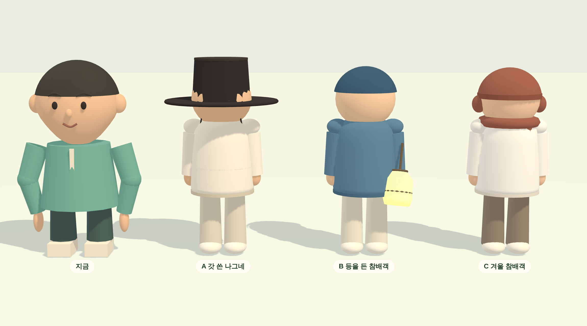

# v8 개선 기획안 — sansatemple 벤치마킹 (2026-11-14)

사용자 요청: *"벤치마킹하고 싶으니까 v8 개선안 보고해봐 (캐릭터만 말고, 전체적으로). 동자승은 하지말고 다른걸로."*
기준 분석은 `docs/SANSA_REFERENCE_2026-11-14.md`. **아직 코드는 고치지 않았습니다.**

## 1. 숫자로 본 차이

세어 봤습니다.

| | v8 | sansatemple |
| --- | --- | --- |
| 장면 | **9** | 1 (방만 여러 개) |
| 활동 | **38** | **4** (합장·절하기·목탁·염주) |
| 화면에 얹힌 UI 덩어리 | **54** | 약 10 |
| 분위기 | 계절 4 × 시간 4 + 날씨 = **16+** | **해질녘 하나** |
| 메뉴 | 하단 5 + `이곳의 활동` + 모바일 시트 | **없음** |

**같은 장르인데 표면적이 열 배입니다.** 저쪽이 이긴 방식은 더하기가 아니라 빼기였습니다.
이 기획안의 대부분도 더하는 게 아니라 **덜어내는 것**입니다.

## 2. 개선 ① — 화면을 덜어낸다 (가장 큼)

지금 상시 요소 54개가 네 군데로 흩어져 있습니다. 레벨·경험치는 프로필 카드에, 마음잎은
별도 알약에, 일지는 하단 네비에, 소지품은 또 하단 네비에.

- **상시로 남길 것 넷**: 장소 이름 / 지금 할 일 하나 / 대화 / 아래 단추 줄.
- **프로필 하나로 합칠 것**: 레벨·경험치·마음잎·일지·배낭. 하단 네비 5 → 2 (지도·나).
- **`이곳의 활동` 목록을 없앤다.** 걸어가서 그 앞에서 작업 단추를 누르는 길이 이미 있습니다.
  목록은 그 길을 건너뛰는 지름길이라, 걸어 다닐 이유를 스스로 없애고 있었습니다.
  (대신 길 안내는 남깁니다 — `등불사장에 가 볼까요?` 같은 한 줄.)
- 모바일은 이미 `m-simple` 로 한 번 줄였습니다. PC 도 같은 수준으로 내립니다.

## 3. 개선 ② — 화면에 밝은 점을 하나 만든다

저쪽 화면에서 가장 밝은 곳은 **법당 문 안의 금빛 하나**뿐입니다. 눈이 거기로 갑니다.
v8 은 전체가 고르게 밝아서 어디를 보라는 건지 없습니다.

- 전체 밝기를 **한 단계 낮추고**, 밝은 점을 두 곳만 남깁니다:
  **① 손에 든 등 ② 전시벽의 걸린 등.**
- 이러면 ①의 캐릭터 안(아래 B)과 바로 이어집니다. 밤에 사람이 모이면 마당이 등불로 찹니다.
  **게임 제목이 그것입니다.**

## 4. 개선 ③ — 분위기를 하나로 깊게

계절 4 × 시간 4 = 16가지를 다 돌보느라 어느 하나도 깊지 않습니다.
사용자가 전에 *"계절 색은 1년 동안 접속해야 확인하는 거냐"* 고 한 지적과 같은 선입니다.

- **해질녘 하나**를 기본으로 정하고 거기만 제대로 만듭니다(하늘 두 단, 안개 낀 먼 산,
  긴 그림자, 따뜻한 역광). 나머지 시간대는 남겨 두되 공들이지 않습니다.
- 쓰는 색을 줄입니다. 저쪽은 갈색·회색·남색 + 겨자 하나입니다.

## 5. 개선 ④ — 캐릭터 (동자승 말고)

기준에서 뽑은 다섯 규칙만 가져오고, 복식은 다른 것으로 합니다.

1. **머리카락을 만들지 않는다**(덮개로 해결) — 바가지 머리가 지금까지 가장 큰 문제였습니다
2. **큰 색면 두 개** — 멀리서 읽히는 건 가는 선이 아니라 면입니다
3. **목이 없다** — 머리가 어깨에 바로 얹힙니다
4. **약 3.2~3.4등신**, 모서리 전부 둥금
5. **완전 무광**, 테두리·무늬·질감 없음

| | 무엇 | 왜 |
| --- | --- | --- |
| **A 갓 쓴 나그네** | 검은 갓 + 미색 두루마기 + 남색 띠 | 카메라가 내려다보므로 **둥근 챙이 화면에서 가장 또렷한 형태**가 됩니다. 한국적이고 헷갈릴 수 없습니다 |
| **B 등을 든 참배객** ★ | 쪽빛 저고리 + 미색 바지 + 두건 + **손에 든 등** | 캐릭터가 곧 화면의 밝은 점입니다. 개선 ②와 한 몸이고, 제목과 같습니다 |
| **C 겨울 참배객** | 흰 솜옷 + 밤색 털모자·목도리 | 포근하지만 셋 중 가장 평범합니다 |

**추천은 B 입니다.** 해질녘 그림에서 눈에 들어오는 것이 그 등 하나입니다.
A 는 실루엣이 가장 셉니다. 둘을 섞어도 됩니다(갓 쓰고 등 들기).

시안 코드는 `docs/concept/character-v2.js`. 마감은 거칩니다.

## 6. 개선 ⑤ — 소리

저쪽은 `염불 듣기` 단추 하나입니다. v8 의 `bgm.js` 는 Web Audio 합성 선율뿐이고
**환경음이 없습니다**(바람·풍경·새·발소리). 환경음 한 겹이 분위기에 가장 싸게 기여합니다.
외부 음원은 받지 않으므로 합성으로 만듭니다.

## 7. 개선 ⑥ — 첫 30초

- 저쪽: 들어가면 **바로 문 앞**. 할 일 네 개가 전부 보임.
- v8: 이름 짓기 → 모습 고르기 → 안내 → 메뉴. **고를 것이 먼저 나옵니다.**
- 바꿀 것: 이름만 받고 바로 들여보낸 뒤, 모습은 걷다가 언제든 고치게 합니다.
  (지금도 `details` 로 접혀 있지만 여전히 시작 화면에 있습니다.)

## 8. 순서와 크기

| | 일 | 건드리는 곳 | 크기 |
| --- | --- | --- | --- |
| 1 | 대화를 상시 패널로 (별도 기획안) | features.js · CSS | 중 |
| 2 | 화면 덜어내기 | app.js HUD · CSS | 중 |
| 3 | 캐릭터 B | avatar-social.js | 중 |
| 4 | 밝은 점 둘 + 전체 밝기 | 조명·전시벽 | 소 |
| 5 | 해질녘 하나로 | environment.js | 소 |
| 6 | 환경음 | bgm.js | 소 |
| 7 | 첫 30초 | app.js 온보딩 | 소 |

## 9. 하지 않는 것

- **저쪽 화면·에셋·코드를 가져오지 않습니다.** 같은 장르·같은 소재라 닮는 부분은
  있어도 모델과 코드는 직접 만듭니다. 저쪽 캡처를 저장소에 넣지 않습니다.
- 장면 아홉을 줄이지 않습니다. 이미 만든 공간입니다. 줄이는 건 **화면에 얹힌 것**입니다.
- 접속 인원 작업을 더 하지 않습니다(relay 80명은 이미 PASS, 병목은 사람 수입니다).
