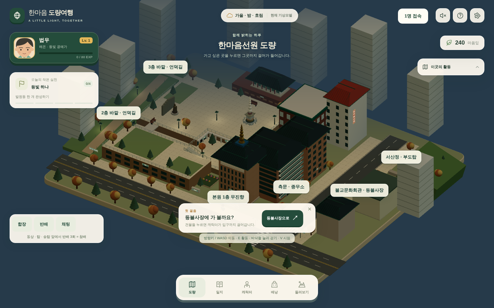
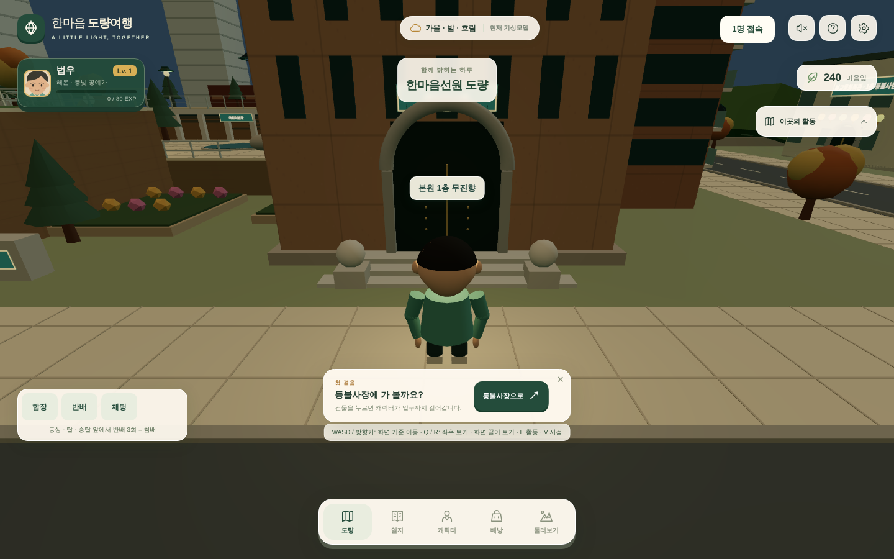

# v8 카메라·UI 기획안 — "실제 법당 가는 느낌" (2026-11-14)

사용자: *"산사는 실제 법당 가는 거같은 느낌이 들어서 좋은거같거든. UI 도 살펴서 벤치마킹해서
기획안 보고해. 카메라 시점도 봐봐."* (캐릭터는 이번에 제외)

**아직 코드는 고치지 않았습니다.**

## 1. 그 느낌은 무엇으로 만들어지나 — 여섯 가지

sansatemple 을 다시 보고 분해했습니다.

1. **카메라가 사람 눈높이에 있다.** 어깨 너머에서 살짝만 내려다봅니다. 내가 거기 서 있습니다.
2. **일주문 → 돌길 → 법당의 순서가 있다.** 실제 절의 진입 동선 그대로라서,
   **건축이 이야기를 합니다.** 안내문이 필요 없습니다.
3. **깊이가 층층이 있다.** 사람 → 길 → 문 → 법당 → 먼 산 → 하늘. 안개가 멀리를 흐립니다.
4. **길이 한 방향이다.** 지도도 목록도 없습니다. 빛 쪽으로 걷기만 하면 됩니다.
5. **빛이 안에 있다.** 화면에서 유일하게 밝은 곳이 법당 문 안입니다.
6. **다른 사람도 같은 쪽으로 걷는다.** 참배 가는 줄에 섞인 느낌이 납니다.

## 2. v8 은 어디서 그 느낌을 잃는가

### 가장 큰 것 하나 — 도량이 조감도입니다

- `public/v8.html:8532` — `if (id === 'campus') this.viewMode = 'explore'`
- `:8539` — 사용자가 바꾸려 해도 **다시 `explore` 로 되돌립니다.**
- `explore` 는 **OrthographicCamera**(`-30..30 / -22..22`)입니다. **원근이 없습니다.**
  멀고 가까움이 생기지 않습니다.

결과는 위 그림입니다. **건축 모형을 내려다보는 화면**이고, 캐릭터가 어디 있는지도 안 보입니다.
장소 이름표 일곱 개가 공중에 떠 있습니다. 이것은 장소가 아니라 **지도**입니다.

### 그런데 고칠 것이 이미 다 있습니다

**같은 장면입니다.** `viewMode` 를 `chase` 로 바꾸고 `eyeCamera`(PerspectiveCamera, fov 70)를
쓰게 한 것뿐입니다. 다른 장면들은 이미 이렇게 돌고 있습니다. **campus 만 한 줄로 막혀 있습니다.**

### 나머지 넷

- **지평선이 비어 있습니다.** 먼 산도 안개도 하늘 그러데이션도 없어 초록 평면이 뚝 끊깁니다.
  깊이의 층이 셋(사람·건물·바닥)뿐입니다.
- **진입 동선이 없습니다.** 문을 지나 들어가는 순서가 없고, 어디로 가라는 것을 **이름표가**
  말합니다. 건축이 아니라 UI 가 안내를 하고 있습니다.
- **빛이 고릅니다.** 화면 전체가 고르게 밝아 눈이 갈 데가 없습니다.
- **카메라가 높습니다.** `chase` 로 바꿔도 눈높이 **4.45** 입니다. 캐릭터 키가 약 2.2 이니
  **사람 키의 두 배** 위에서 봅니다.

## 3. UI 벤치마킹

### 세어 본 것

| sansatemple (묶음 5) | v8 campus 에 **동시에** 보이는 것 (실측 9) |
| --- | --- |
| 좌상단: 뒤로·지도·방 | `topbar` |
| 우상단: 날씨·소리·설정 | `profileCard` |
| 하단 알약: **합장·절하기·목탁·염주** | `currencyPill` |
| 머리 위 이름표 | `roomInfo` |
| 상단 한 줄 안내 | `sceneTools`(이곳의 활동) |
| | `firstGuide` |
| | `socialActions` |
| | `walkHint` |
| | `bottomNav` |

### 무엇이 다른가 (개수가 아니라 성격)

1. **sansa 의 하단 알약은 "할 일 전부"입니다.** 넷이 전부이고 넷이 다 보입니다.
   **v8 의 하단 네비는 "창 목록"입니다**(도량·일지·캐릭터·배낭·둘러보기). 할 일이 아닙니다.
2. **v8 에는 같은 정보가 두세 번 있습니다.**
   장소 이름 → `roomInfo` + 공중의 장소 이름표.
   할 일 → `sceneTools` + `firstGuide` + `interaction`.
3. **`이곳의 활동` 은 sansa 에 없고, 있으면 걸어갈 이유가 없어집니다.** 목록에서 고르면
   되는데 왜 걷겠습니까. 걷는 느낌을 UI 가 스스로 깎고 있습니다.

### 제안하는 배치

- **좌상단**: 장소 이름 + 뒤로. `profileCard`·`currencyPill` 은 눌러서 보는 것으로 넣습니다.
- **우상단**: 접속·소리·설정 (지금과 같음, 줄만 맞춤)
- **하단 가운데: 늘 같은 네 개.** 장면마다 바뀌지 않습니다.
  `합장 · 절하기 · 등 만들기 · 밝혀 주기`.
  **장면마다 메뉴가 바뀌지 않는 것**이 sansa 가 쉬워 보이는 진짜 이유입니다.
- **하단 왼쪽**: 마당 소식 패널(`docs/V8_CHAT_REDESIGN_2026-11-14.md`)
- **유지**: 머리 위 이름표, 상단 한 줄 안내
- **프로필 안으로**: 일지 · 배낭 · 둘러보기 · 이곳의 활동

## 4. 카메라 기획

| | 지금 | 바꿀 값 | 왜 |
| --- | --- | --- | --- |
| 1 | campus 가 `explore` **강제** | 기본 `chase`, `전체 보기` 는 단추로 남김 | 이것 하나가 가장 큼 |
| 2 | 눈높이 **4.45** | **2.6~2.8** | 사람 키 2.2 기준 어깨 조금 위 |
| 3 | 많이 내려다봄 | 각을 눕혀 **지평선이 화면에 들어오게** | 하늘이 보여야 밖에 있는 느낌 |
| 4 | fov **70** | **55** | 70 은 넓어서 가장자리가 휩니다 |
| 5 | 안개 없음 | **three.js `fog` 한 줄** + 먼 산 실루엣 두세 겹 | 깊이를 가장 싸게 만듦 |
| 6 | 나올 때 방향이 제각각 | 등불사장에서 나오면 **문을 등지고 법당을 마주** | 진입 동선이 생김 |

5번이 **비용 대비 효과가 가장 좋습니다.** `scene.fog = new Fog(색, 가까움, 멂)` 한 줄로
먼 건물이 흐려지고 층이 생깁니다.

## 5. 순서

| | 일 | 크기 |
| --- | --- | --- |
| 1 | 카메라 1~4 (강제 해제 · 눈높이 · 각 · fov) | **반나절. 효과 가장 큼** |
| 2 | fog + 먼 산 + 하늘 그러데이션 | 반나절 |
| 3 | UI 정리 (하단 네 개 고정 · 중복 제거) | 하루 |
| 4 | 진입 동선 (나오는 방향 · 문 통과) | 반나절 |

## 6. 앞 기획과의 관계 — 섞지 않습니다

- **이번 것**(카메라·UI)은 **"온 사람이 더 좋게 느끼는 것"** 입니다.
- **앞 것**(마당 소식 · 등이 산다 · 등 주소)은 **"사람이 오고 다시 오는 것"** 입니다.

둘 다 필요합니다. 사용자가 느낌을 먼저 말했으니 이번 것을 먼저 해도 됩니다.
다만 **카메라를 고친다고 사람이 오지는 않는다**는 점은 적어 둡니다.

## 7. 확인 방법

- 같은 자리에서 찍은 두 장(위 그림)을 바꾼 뒤와 비교합니다.
- 눈높이·fov·fog 는 숫자로 적어 둡니다.
- 모바일 세로에서 지평선이 너무 높이 올라오지 않는지 봅니다(fov 가 좁아지면 더 좁아집니다).
- `전체 보기` 단추로 예전 조감도가 그대로 나오는지 — **지도를 없애는 게 아니라
  기본에서 내리는 것입니다.**
