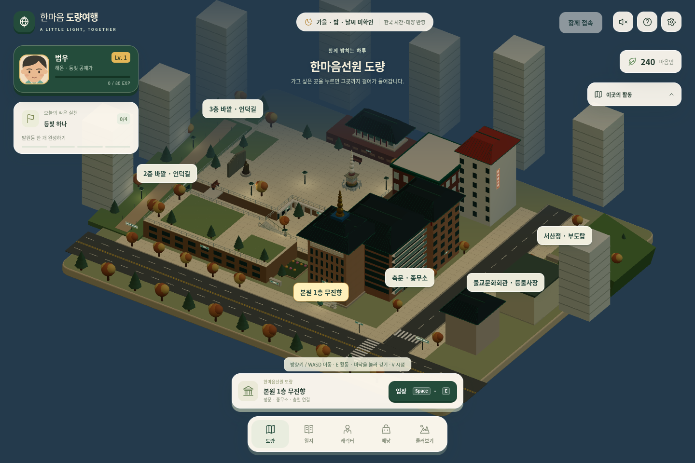
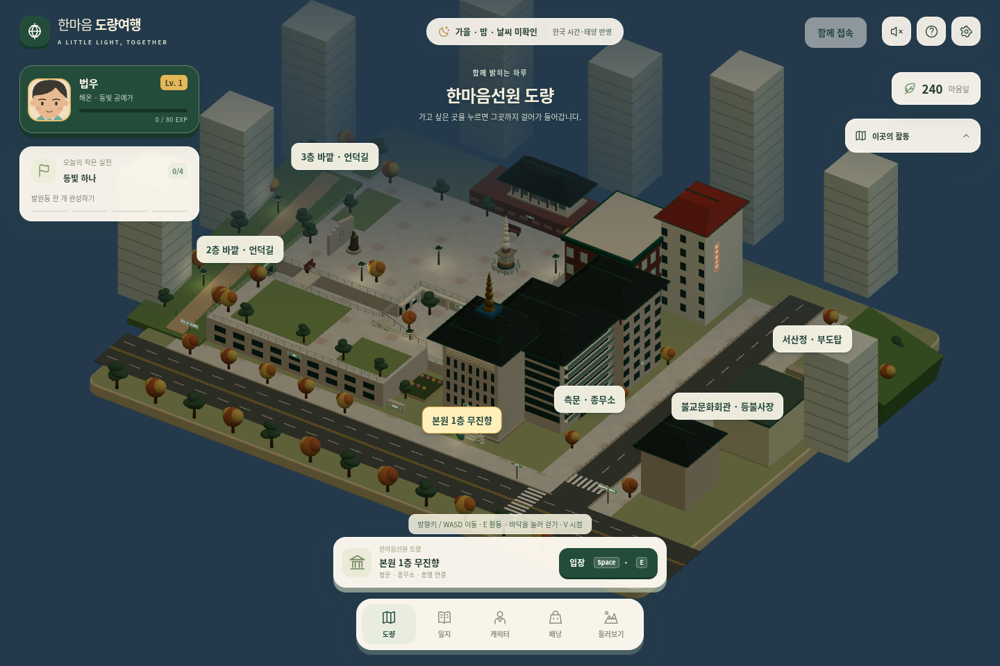
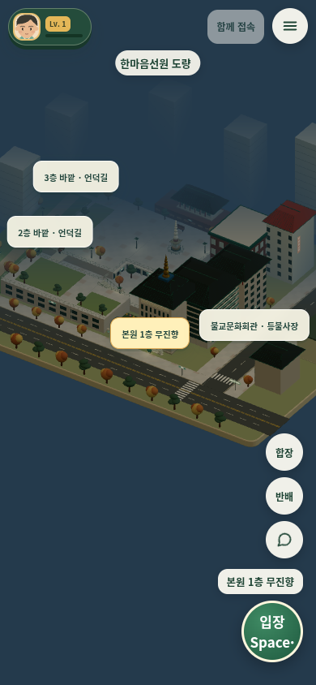

# v8 도량: 뉴스 사진을 참고한 외관 개선

## 실제 구현

기준 main: `a4ae14d` (PR #50). 별도 브랜치 `codex/v8-courtyard-photo`.

- 마당·보도: 밝은 화강석 타일, 절제된 분홍색 끼움돌, 낮은 대비의 줄눈·입자 재질.
- 석재 외벽: 분홍빛 회색 석재와 패널 줄눈. 기존 외벽 mesh를 재사용한다.
- 짙은 기와지붕: 반복되는 기와 질감과 기존 처마 안쪽의 얇은 단청 띠.
- 소나무: 원뿔 세 겹 대신 비대칭의 낮고 넓은 수관. 기존 계절별 나뭇잎 일괄 렌더링과 연결한다.

승인된 생성 시안의 분위기를 기존 게임에서 구현하는 외관 단계다. 유리문 조각·배수로·탑 기단 추가 모델링, 서산정 사실화는 이 PR에 포함하지 않는다. 도량의 실제 측량·배치 교정도 하지 않는다. 2D 대체 렌더러는 기존 그대로다.

## 사진 출처

- [2026 백중등 운력](https://hanmaum.org/one_news/419): 위에서 내려다본 석재 마당, 계단, 탑 주변 석재와 조경.
- [2026 부처님오신날 회향 운력](https://hanmaum.org/one_news/413): 석재·붉은 벽돌 외벽, 기와, 단청과 칠보탑.
- [2026 부처님오신날·점등식](https://hanmaum.org/one_news/412): 계단·난간·마당 재질.

사진 자체는 저장소나 앱에 넣지 않았다. 256×256 CanvasTexture 네 종류를 코드로 생성한다. 행사 가설물·연등망·인원은 상설 조경으로 추가하지 않았다.

## Claude와의 분리

`public/v8-courtyard-photo.js`가 외관만 담당한다. `public/v8.html` 수정은 `app.js` 바로 앞 script 로더 **한 줄**이다. 모바일 인사, 메뉴, 캐릭터 시안, 이동속도, 채팅, 전시벽, Supabase/relay 코드는 편집하지 않았다.

`buildSite()` 실행 중에만 paving/stoneMaterial/roof/tree helper를 임시 보완하며 finally에서 원래 property descriptor를 복원한다. 건물·탑·동상·동선의 좌표, 충돌, 층 이동, 카메라는 기존 buildSite가 유일하게 정한다. 별도 지도 복사본이 없다. 새 재질은 매 build에서 생성되고 기존 `_textures`/`disposeGroup` 정리와 `mergeStatic`을 따른다.

Claude가 `buildSite`를 고치더라도 그 결과를 그대로 꾸민다. 이후 helper의 인자·반환 구조를 변경한다면 이 wrapper의 호환성 검토가 필요하다. 로더의 위치는 upgrade.js 이후, app.js 이전을 유지한다. 열린 PR이 없음을 확인했지만 다른 작업창의 미공개 수정까지 조회한 것은 아니다.

## 검증

- `node --test tests/v8-*.test.mjs`: 93/93 통과.
- `npm run build`: 통과. 기존 500KB 번들 크기 경고는 남아 있다.
- `git diff --check`: 통과.
- 새 테스트: helper scope 및 예외 복원, 중복 설치 방지, 재입장 시 새 텍스처, 단청 UV 전체 문양 표시. 처음 실패→수정 후 통과를 확인했다.
- 독립 코드 리뷰에서 단청 UV의 세로 범위 오류를 발견했고, 회귀 테스트를 추가하여 수정했다.
- 브라우저 검증 세부와 실행 화면은 아래 기록 참조. 운영 DB 쓰기·운영 다중접속을 피하려 통신 entry를 비활성화한 로컬 환경에서 확인했다.

이 PR은 병합·운영 배포하지 않는다.

### 로컬 Chromium 실행 확인

PC 1440×960 / 모바일 모형 390×844, 소프트웨어 WebGL. 통신 entry를 빈 모듈로 차단했고 날씨 API도 차단했다. 실제 기기의 GPU/Safari 성능을 확인한 것은 아니다. 화면의 날씨·시간 UI는 기존 시간 표시이며, 시안용 UI로 바꾸지 않았다.

기존판/개선판 각각 campus → terrace3 → terrace2 → seosan → hall5 → campus로 전환했다. 각 장면의 obstacles, walkRegions, bounds, ramps, towerCenter, spawn, hotspot 위치/대상과 helper 복원 상태가 JSON 비교에서 동일했다. 각 PC/모바일 실행의 pageerror는 0개. 서산정·대법당의 draw call과 삼각형 수는 전후 동일했다.

| PC 장면 | 기존 draw calls | 개선 draw calls | 기존 삼각형 | 개선 삼각형 |
|---|---:|---:|---:|---:|
| 도량 | 777 | 739 | 268,860 | 273,312 |
| 3층 | 705 | 667 | 254,356 | 259,168 |
| 2층 | 592 | 558 | 169,182 | 174,438 |
| 서산정 | 286 | 286 | 46,154 | 46,154 |
| 대법당 | 988 | 988 | 155,458 | 155,458 |

수치는 명시적으로 한 프레임을 렌더한 결과이며 FPS·실기기 처리 인원 보장이 아니다. 시야에 따라 달라진다. 도량 재입장 후 렌더러 텍스처는 기존 30개/개선 27개, 서산정 6개·대법당 5개로 돌아갔다. 상세 결과: [browser-results.json](review/v8-courtyard-photo/browser-results.json).

#### 기존 실행 화면

#### 개선 실행 화면

