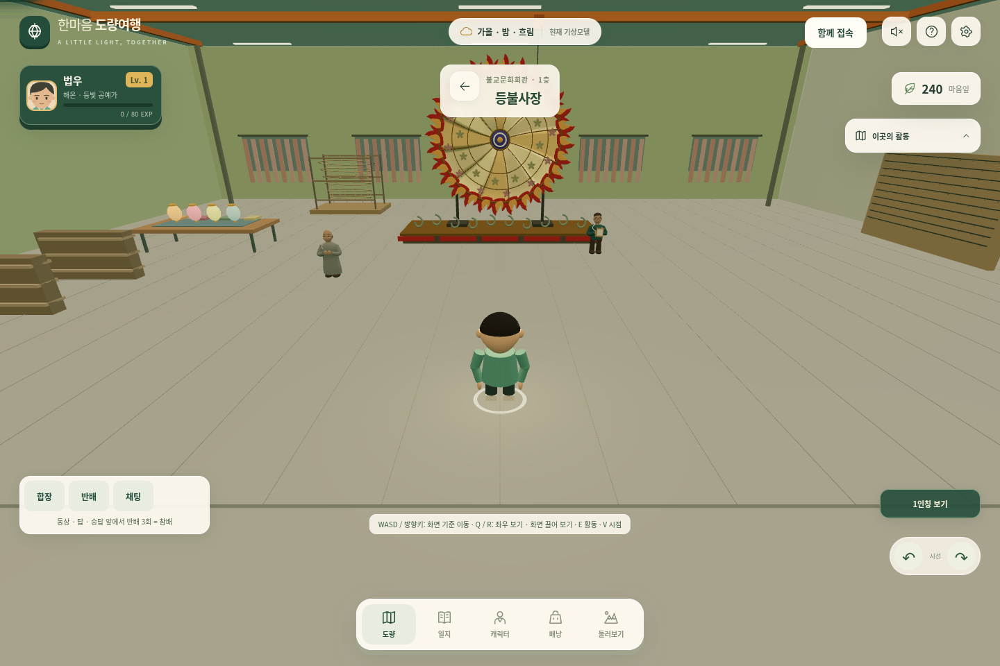
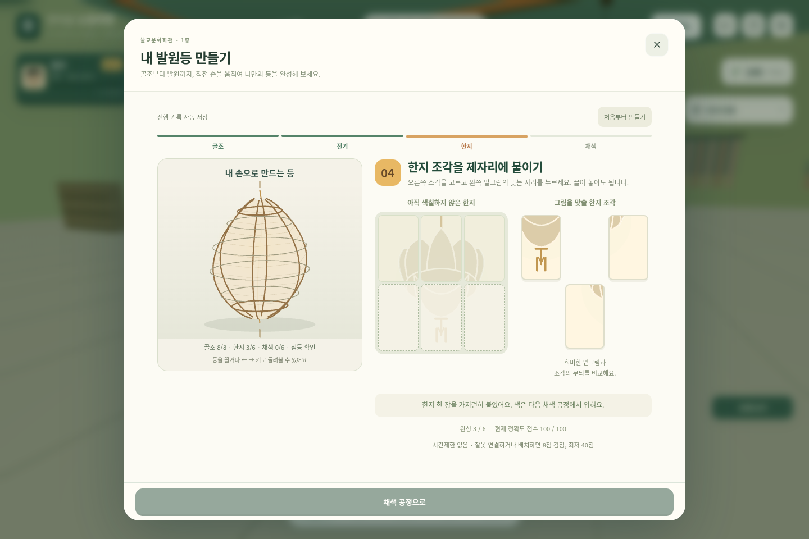
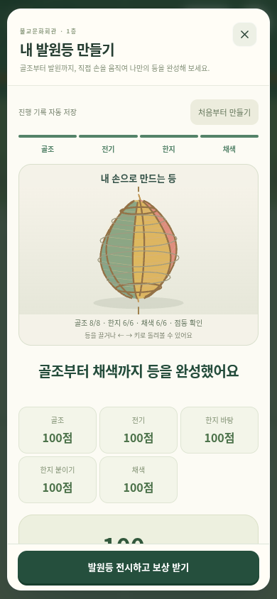

# v8 등불사장 · 제작 과정

기준 main: 81a5d30. 작업 브랜치: codex/v8-modern-workshop.

## 반영 사항
- 실내 48×36, 면적 1,728: 직전 1,134 대비 약 1.52배. 구조 높이 11.4, 상부 조명과 크레인 재배치.
- 불바퀴등 1.45배, 중앙 (0, -3.2). 받침/충돌 영역/활동 접근점도 함께 조정. 입구 뒤 카메라에 빈 공간이 보이지 않도록 바닥 문턱 연장.
- 골조→전기→한지→채색을 하나의 제작 모형으로 표시. 끌기/좌우 키 회전, 실제 부품 상태와 전선 연결률 반영. 한지는 바탕 매듭과 붙이기의 두 세부 작업이며 기존 저장 형식과 5개 점수를 보존.
- 모형은 Canvas 투영으로 표현하며 추가 WebGL 렌더러나 지속 애니메이션 루프를 만들지 않음. 닫을 때 observer/listener 정리.
- 캐릭터 변경은 사용자의 재검토 요청으로 배포 범위에서 제외. `avatar-social.js` 블록은 기준 main과 바이트 단위로 동일하게 복원.

## 검증
- v8 Node 회귀 테스트 109개와 빌드 통과(기존 큰 Three 번들 경고 유지).
- Chromium PC 1440×960, 모바일 에뮬레이션 390×844: 골조 8개→회로 연결/점등→매듭 4개→한지 6면→채색 6면→닫기/복원 확인. 동일 모형 DOM 유지, 페이지 오류 없음.
- 활동 접근점 7개와 출구가 모두 충돌 영역 밖. 자동 이동/출입 회귀 테스트 포함.
- 독립 코드 검토에서 발견한 불바퀴등 받침 배율 불일치 수정.
- 처음 브라우저 스크립트의 숨겨진 원본 시작 버튼 클릭 실패는 기존 하단 고정 버튼(#workshopNext)을 사용하도록 점검 스크립트를 고쳐 해결. 제품 버튼 오류로 판정하지 않음.

## 범위와 제약
- 실물 아이폰 Safari 검증과 실제 다중 접속 서버 부하 시험은 이번 변경에서 실시하지 않음. 모바일은 Chromium 에뮬레이션임.
- 제작 모형은 공정 이해를 돕는 간략한 투영 모형이며 모든 해금 모양의 정밀 조형이나 손동작 애니메이션은 아님.
- 캐릭터 새 시안은 검토용이며 이번 운영 코드와 배포에 포함하지 않음.
- 운영 DB 쓰기 기능/보상 수령은 브라우저 시험에서 실행하지 않음. 통신 모듈을 차단해 로컬 초안만 사용.
- 동시 작업 PR #54(클로드의 시점·UI·조작)는 병합하지 않음. 서로 다른 추가 스크립트이며 카메라 수치는 통합 시 재확인 필요. 이번 PR을 단독 배포하려고 #54 작업을 덮어쓰지 않음.
- 이 문서는 구현 검증 기록이며 운영 배포 완료를 뜻하지 않음.

## 실제 화면

