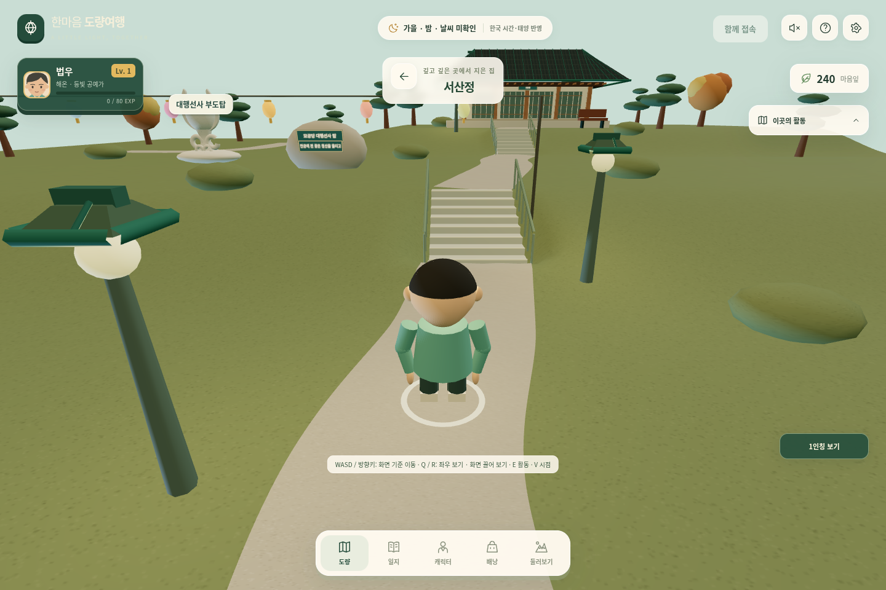
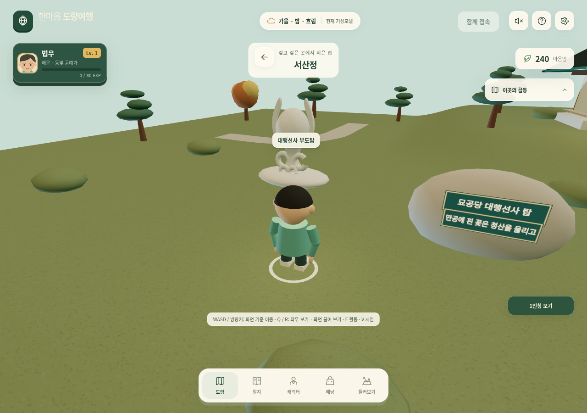
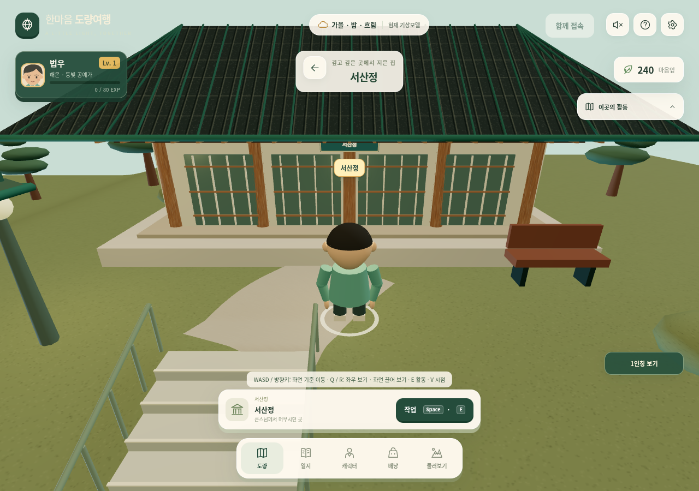
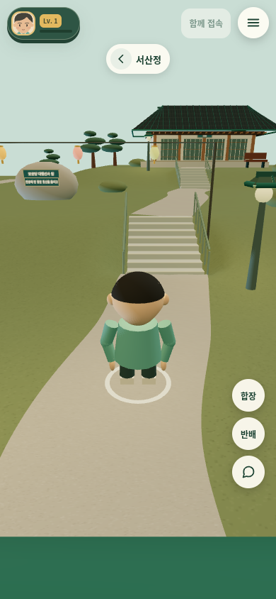

# v8 서산정 사진 기반 구현

기준 main `5c3dd0a`(본원 외관 PR #51). 사용자 승인 시안을 브라우저용 3D 모형으로 구현한다. 사진과 같은 실측·고밀도 복원이라는 의미는 아니다.

## 변경

- 부도탑: 원뿔 꽃잎·황금 점을 제거하고 석재 봉오리, 감싸는 곡선 꽃잎, 말린 받침, 낮고 넓은 자연석 기단으로 교체했다. 기존 위치·참배 hotspot·충돌은 유지했다.
- 지형: 사각 잔디 블록을 연속된 경사면으로 교체했다. 입구 0, 부도탑 1.6, 건물 3.2의 기존 기준 높이를 유지한다. 원래 두 계단은 유지했다.
- 길: 기존 입구/계단/건물 앞/둘레길을 연결하는 절제된 색의 곡선길. 폭 방향도 세분화해 잔디 곡면을 따른다.
- 건물: 기존 자리와 크기를 유지하며 목재 결·유리색 창호·가로 살대·처마 서까래·기와 질감을 보완했다.
- 조경: 원뿔 소나무를 낮고 넓은 비대칭 수관으로 바꾸고, 관목을 낮췄다. 계단을 가리던 장식 돌 띠는 제거했다. 등줄의 높이는 유지하면서 지지대 바닥을 잔디에 맞췄다.

## 사진 출처

- [공식 서산정 안내](https://hanmaum.org/content/one_tour_09)
- [공식 부도탑 설명](https://hanmaum.org/content/one_daehaeng_01)
- [영문 공식 서산정 사진](https://hanmaumseoncenter.org/sosanjeong-daehaeng-kun-sunims-residence-and-the-site-of-her-pagoda/)
- [2017 서산정 탐방](https://hanmaum.org/one_news/70)
- [2024 열반 다례재](https://hanmaum.org/one_news/327)

과거 사진도 포함한다. 실제 최신 배치·건물 뒷면·정확한 치수는 확정하지 않았다. 앱에 사진 원본이나 생성 시안 이미지를 넣지 않았다. 새 재질은 모두 절차적 CanvasTexture다.

## 다른 작업과 분리

새 파일 `public/v8-seosan-photo.js`와 `public/v8.html` 로더 한 줄만 추가한다. 기존 본원 외관 파일, UI·모바일 인사·캐릭터·통신·DB·게임 진행을 수정하지 않았다. `buildSeosan` 생성 후 정적 병합 전에 시각 모형을 보완한다. 원래 build가 출입구·hotspot·bounds·walkRegions·obstacles·카메라를 계속 결정한다.

부도탑/건물 모형을 교체·보완한 뒤 기존 클릭 태그를 유지한다. 장면을 떠나면 기존 setScene/disposeGroup/_textures가 재질과 지형을 정리한다. 2D fallback은 기존 서산정 그대로다.

## 지형·길 검증

- 연속 지형 생성 후, 실제 PlaneGeometry 삼각형의 높이를 보간해 `terrainHeight`를 정한다. 길·나무·관목도 같은 높이를 사용한다.
- 기존 계단의 ramps·groundHeight 우선순위는 유지했다. 실제 계단 단차가 선형 ramp보다 최대 0.2 높은 기존 현상은 유지된다(이번 변경 전후 raycast에서 동일). 이를 모든 계단 발 접지 개선 완료로 표현하지 않는다.
- 독립 리뷰에서 길 내부의 지형 오차와 등줄 지지대 접지를 지적했다. 길 폭을 12분할하고 실제 렌더 지형에 맞추도록 수정했다. 단위 검사에서는 길 삼각형 내부를 실제 Three.js Raycaster로 검사해 잔디 아래로 숨지 않는 것을 확인했다.
- 새 검사: 입구/부도탑/건물 기준 높이, 연속성, 계단 ramp, 재입장 텍스처, 중복 로드 방지, 예외 시 helper 복원, 위를 향하는 길 면, 길 내부 높이, 지지대 양 끝, 실제 잔디 mesh와의 간격.

## 실행 검증

운영 DB 쓰기를 피하기 위해 로컬 브라우저에서는 통신 entry를 차단했다. PC 1440×960 / 모바일 모형 390×844 Chromium, 소프트웨어 WebGL. 화면 검토를 위해 조명만 일시적으로 낮으로 맞췄으며 제품의 시간·날씨 UI/로직은 바꾸지 않았다. 실물 iPhone/Safari·FPS·다중접속 성능은 검증하지 않았다.

원래 두 계단에 대해 실제 update 이동 입력으로 낮은 쪽→높은 쪽 통과를 확인한다. 비교 대상은 기존판과 개선판의 출입구·충돌·영역·계단 구조다. 바닥 높이 자체는 새 경사를 의도적으로 반영한다.

### 최종 결과

- v8 회귀 검사 101/101 통과. 빌드·git diff --check 통과. 기존 번들 500KB 경고는 남아 있다.
- PC/모바일 pageerror 0. 기존판과 개선판의 hotspot·출입구·충돌·영역·램프·spawn JSON이 동일했다.
- 본원→대법당→서산정 전환 후 본원/대법당에는 terrainHeight가 남지 않았으며 box helper도 복원됐다. 텍스처 배열은 본원 25 / 대법당 2 / 서산정 9로 돌아왔다.
- 기존 두 계단을 실제 update()의 이동 입력으로 통과했다: (3,14.4)→(3,8), (7,-4.5)→(7,-10.9). 보행 높이는 groundHeight+.12와 일치했다. 렌더된 계단 단차의 기존 차이는 위 한계에 별도로 적었다.
- 오른쪽 등줄 지지대는 계단 밖 x=4.8로 옮기고 선을 연장해 연결했다. 건물·탑·출입구의 위치는 바꾸지 않았다.

| 화면 | Draw calls | 삼각형 |
|---|---:|---:|
| PC 기존 | 286 | 46,154 |
| PC 개선 | 246 | 98,986 |
| 모바일 모형 개선 | 231 | 94,276 |

지형·곡선길·부도탑 세부로 삼각형 수가 증가했다. 이 측정은 한 시점의 소프트웨어 렌더 통계이며 실기기 FPS 보장이 아니다. 원본 비교/샘플/보행 결과: [browser-results.json](review/v8-seosan-photo/browser-results.json).

### 실제 실행 화면

