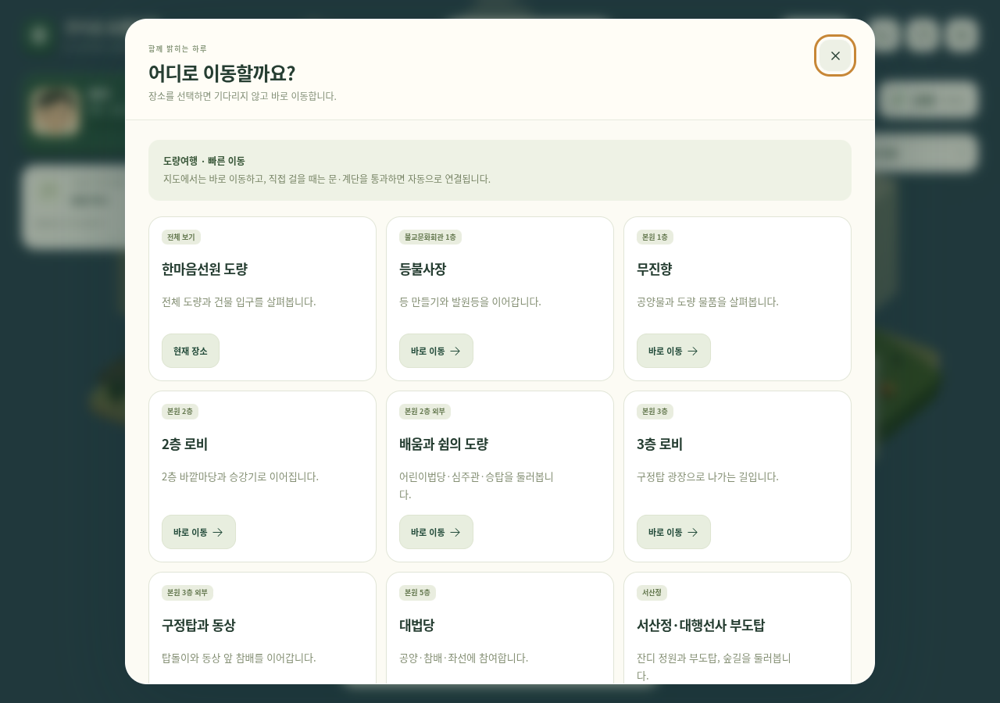
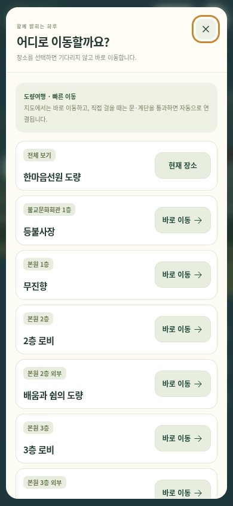

# v8 자동 출입과 지도 즉시 이동

기준 main `e23b6c4`(#52). 사용자 요청: PC·모바일 양방향 자동 출입, 계단 연결, 안전한 도착/시선, 이동 취소/안내, 지도에서 선택하면 걷지 않고 즉시 이동. 서산정 내부 장면을 새로 만들거나 참배·제작·설명을 자동 실행하는 변경은 아니다.

## 동작

- 직접 걸을 때 문·계단 연결선을 정해진 방향으로 통과하면 이동한다. 근처에 서 있거나 옆으로 지나가기, 다른 높이에서 접근하기는 이동 조건이 아니다.
- 문 이름을 클릭/터치하면 문까지 걸은 뒤 자동으로 이동한다. 기존 입장/퇴장/E/Space 버튼도 남긴다.
- 직접 접근한 승강기는 층 선택을 연다. 활동 안내에서 이미 목적 층을 선택했다면 그 층까지 이어서 안내한다.
- 지도는 전체 도량·등불사장·무진향·2층 로비·2층 바깥·3층 로비·3층 바깥·대법당·서산정 아홉 장소로 즉시 이동한다. 현재 장소 선택은 창만 닫는다.
- 지도 이동 시 이전 경로를 취소한다. 직접 걷기/바닥 클릭도 이전 자동 안내를 취소한다. 활동 안내 중에는 ‘안내 중지’ 버튼을 표시한다.
- 도착 시 출입구 바깥이 아닌 안전한 쪽으로 배치하고 시선을 맞춘다. 입력을 초기화하며 짧은 안정 시간과 방향 통과 판정으로 즉시 왕복을 막는다. 다시 돌아서 퇴장하는 것은 허용한다.
- 범위 밖에 있던 3층 언덕 출구의 실제 판정/걷기 목표를 이동 가능한 범위 안으로 보정했다. 건물과 지형을 이동하지 않았다.
- 모바일 지도는 한 줄에 한 장소, 최소 44px 버튼으로 표시한다. 기본 3D를 사용할 수 없는 경우에도 2D 로비·서산정과 같은 이동 연결을 제공한다(간략 모형).

## 구현 경계

`public/v8-travel.js`가 공간 그래프/출입선/재진입 방지/기존 World와 2D World의 연결을 담당한다. `v8-travel.css`는 이동 안내 및 지도 카드에만 적용한다. app의 enterScene/showElevator/routeTo/지도 버튼과 통합했다. 통신·캐릭터·DB·환경변수·의존성·본원/서산정 사진 기반 외관 파일은 편집하지 않았다.

독립 리뷰 지적 3건을 반영했다.

1. 바닥 클릭은 walkToPoint 외에 goTo를 직접 쓰므로 goTo 경계에서 취소한다. 문 경로를 계산하는 내부 호출은 구분한다.
2. 문에서 1.6칸 떨어진 도착점이 1.9칸 재활성화 반경 안에 갇히지 않도록, 안정 시간 후 안전한 안쪽에서 재활성화한다. 바로 돌아서 나가는 검증을 추가했다.
3. 2D의 hillDown/backCampus 별칭을 경로 진행에서도 동일하게 처리한다.

지도 즉시 이동은 걷기 안내와 별도다. 경로 그래프는 기존 활동/NPC 목적지 안내 등에 쓰며, 지도 버튼은 자동 걷기를 시작하지 않는다.

## 검증

- `node --test tests/v8-*.test.mjs`: 107/107 통과.
- `npm run build`, `git diff --check`: 통과. 기존 번들 500KB 경고는 남아 있다.
- 그래프의 아홉 공간 전체 출발/목적지 조합, 방향·높이·문 옆 통과·정지, 재진입 방지·바로 되돌아가기, 바닥 클릭 취소를 node 검사로 확인했다.
- PC 1280×900 / 모바일 모형 390×844 Chromium에서 기본 3D의 출입/계단 연결 22개씩 이동 입력으로 확인했다. 정지 시 이동 없음, 도착 후 튕겨 돌아감 없음. 층 선택 문은 floors 창으로 확인했다.
- PC/모바일 각각 지도 아홉 버튼을 실제 DOM 클릭해 즉시 목적 장면이 되는 것을 확인했다.
- WebGL을 차단한 2D 대체 화면에서도 PC/모바일 각각 연결 21개 및 지도 아홉 버튼을 확인했다. 기본 3D의 측문 한 개가 없는 간략 지도다.
- 3D/2D 모두 작업장 입장 후 바로 돌아서 퇴장, 바닥 클릭 취소, 모달 중 출입 방지, 모달 종료 후 오래된 통과 무효화를 확인했다.
- 활동 안내 경로: 무진향→대법당, 2층 로비→2층 바깥→도량→서산정, 3층 바깥→도량→등불사장이 3D/2D 모두 이어졌다. 실제 검증에서는 각 연결 앞에서 이동을 시작해 전환/안내의 연속성을 확인했다. 전체 긴 거리를 실제 시간으로 끝까지 걷는 부하 검사는 아니다.
- 키보드 D로 도량→등불사장, 모바일 문 이름 터치로 서산정→도량 전환을 추가 확인했다. 모바일 최초 조작 안내를 닫고 검사했다. 최초 안내 표시 타이머를 기다리지 않은 초기 자동화는 안내에 가로막혔으므로 해당 시도는 통과 근거에서 제외했다.
- 위 3D/2D 실행의 pageerror는 0개. 운영 DB 쓰기를 피하도록 통신 entry를 빈 모듈로 차단한 로컬 검증이다. 실물 iPhone/Safari/안드로이드 및 실제 다중접속 부하는 검증하지 않았다.

결과: [기본 3D](review/v8-travel/travel-browser.json), [2D 대체 화면](review/v8-travel/travel-fallback-browser.json), [취소·왕복·경로 진행](review/v8-travel/travel-deep.json).

### 지도 실행 화면

동작 줄이기를 켠 Chromium 캡처다. 긴 목록은 내부 스크롤로 선택한다.

