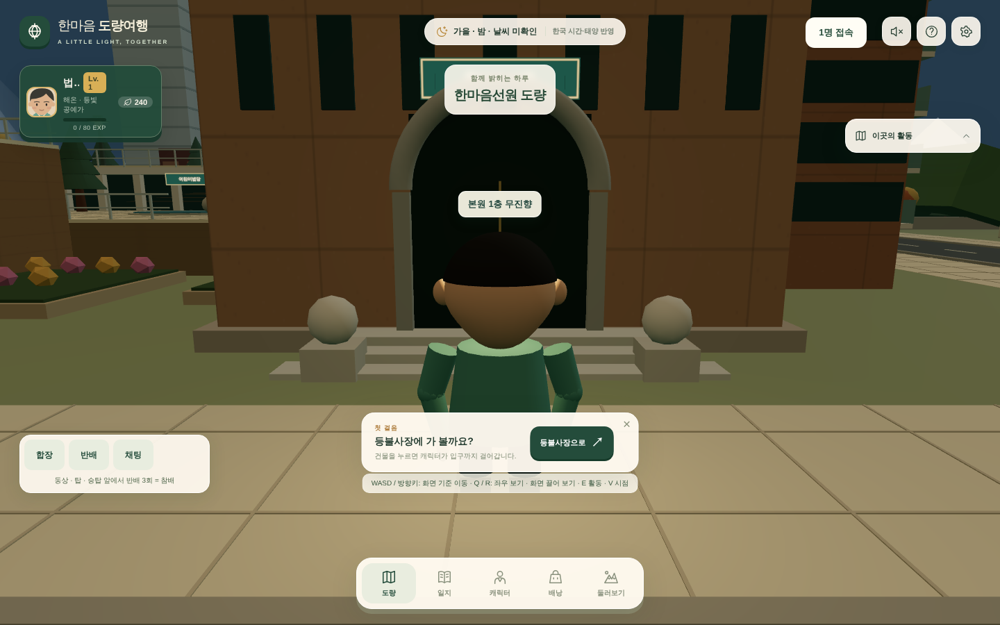
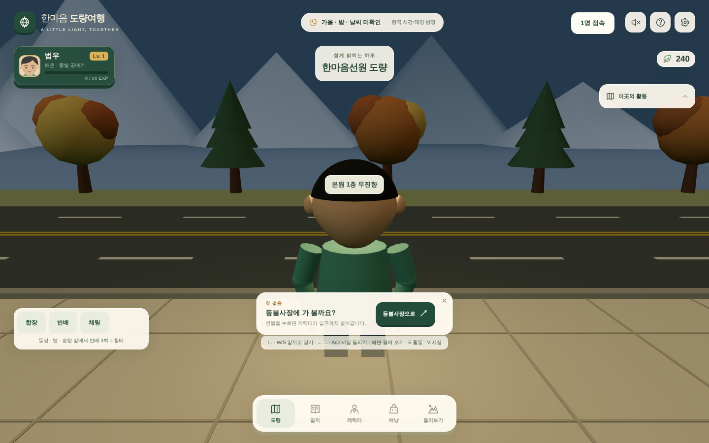

# v8 시점·깊이·조작 구현 (2026-11-14)

기획은 `docs/V8_CAMERA_UI_PLAN_2026-11-14.md`. 그중 **①카메라 ②깊이 ③UI** 를 넣고,
사용자가 따로 말한 **조작 바꾸기**를 함께 넣었습니다.

## 코덱스와 안 겹치게

코덱스는 `public/v8-<주제>.js` 를 따로 두고 `v8.html` 에는 `<script src>` 한 줄만 더합니다
(`v8-courtyard-photo.js`, `v8-seosan-photo.js`). **같은 방식을 그대로 따랐습니다.**

- 새 파일: `public/v8-view.js`, `public/v8-ui.js`
- `public/v8.html` 에 더한 것: `<script src>` **두 줄**
- 그 밖에 `v8.html` 에서 고친 것: **조작 안내 문구 다섯 곳**(조작이 바뀌었으니 필수)
- 코덱스가 지금 들고 있는 브랜치(`v8-courtyard-photo`, `v8-seosan-photo`)는
  `v8-*.js` 새 파일 + `v8.html` 한 줄이라 겹치는 줄이 없습니다.

## ① 카메라 — 도량이 조감도였던 것

- `v8.html:8532` 가 campus 를 `explore` 로 강제하고 `:8539` 가 사용자의 변경을 되돌렸습니다.
  `explore` 는 **OrthographicCamera** 라 원근이 없어 **지도처럼** 보였습니다.
- `v8-view.js` 가 `setViewMode` 를 감싸 **원한 값이 되돌려졌으면 다시 세웁니다.**
  `setScene` 뒤에는 바깥 장면에서 저장된 선택(기본 `chase`)을 적용합니다.
- **`전체 보기`(V·단추)는 그대로입니다.** 지도를 없앤 게 아니라 기본에서 내렸습니다.
  저장된 선택이 `explore` 인 사람은 그대로 조감도로 들어옵니다.

| | 전 | 후 |
| --- | --- | --- |
| 도량 시점 | `explore` 강제 (직교) | `chase` 기본 (원근) |
| 눈높이 | **4.45** | **2.77** (캐릭터 키 약 2.2) |
| 거리 | 6.2 | 5.2 |
| 시야 | 70 / 좁은 화면 84 | **55 / 68** |

눈높이·거리는 원래 `updateCamera` 를 돌린 **뒤에** 결과만 낮춥니다. 벽에 막혀 당겨진 거리는
`Math.min(1, …)` 로 비율을 보존해 **밀어내지 않습니다.** 실내(`indoor`)는 건드리지 않았습니다.

## ② 깊이 — 안개는 원래 있었습니다

`v8.html:5241` 에 `new T.Fog('#c9ddd4', 62, 125)` 가 있었는데 **`near=62`** 였습니다.
도량이 약 63×55 라 **한 번도 걸리지 않았습니다.** 그래서 깊이가 없었습니다.

- 바깥 `near 22 / far 230`, 실내 `near 26 / far 90`.
- 걷는 범위 밖에 **먼 산 세 겹**(반지름 150·205·268)과 넓은 들판을 깝니다.
  충돌도 장소도 만들지 않고 `cameraIgnore` 입니다.
- **산 색은 그때그때 배경색에서 뽑습니다.** 처음에 고정 회색으로 두었더니 밤하늘보다 밝아
  물러나지 않고 종이처럼 떠 보였습니다. `setEnvironment` 를 감싸 낮·밤·날씨를 따라갑니다.

## ③ UI — 보이는 것 줄이기

- `이곳의 활동` 을 **기본으로 접었습니다.** 단추는 그대로라 언제든 펼칩니다.
  (목록이 펼쳐져 있으면 걸어갈 이유가 없어집니다.)
- 공중의 **장소 이름표를 가까운 셋만** 남깁니다. 일곱 개가 다 떠서 지도처럼 보였습니다.
- 마음잎 상자를 작게 줄였습니다.
  **처음에 프로필 카드 안으로 옮겼더니 카드의 flex 배치가 깨져 이름이 `법..` 으로
  잘렸습니다.** DOM 을 옮기지 않고 크기만 줄이는 쪽으로 되돌렸습니다.
- **하단 네비를 `할 일 네 개` 로 바꾸는 것은 하지 않았습니다.** 각 단추가 `onUIClick` 의
  동작과 얽혀 있어 외부 파일에서 안전하게 못 바꿉니다. 기획에 남겨 둡니다.

## 조작 — 위아래 앞뒤, 좌우 시점 돌리기 (사용자 요청)

원래는 좌우가 **옆걸음**이었습니다. 이제

- **↑↓ (W/S)** 바라보는 쪽으로 앞뒤
- **←→ (A/D)** 제자리에서 시점 돌리기 (`turnRate` 2.1 rad/s)
- **조이스틱도 같습니다.** 위아래로 밀면 걷고 좌우로 밀면 둘러봅니다.
- 바닥을 눌러 걷기, Q/R, 화면 끌기는 그대로입니다.
- **조감도(전체 보기)에서는 예전 그대로**입니다. 그 시점에는 회전이 없습니다.

구현은 `update` 를 감싸, 좌우 입력만 회전으로 쓰고 **걷기 계산에서는 빼고 원래 값을
되돌려 놓습니다.** 좌우만 누르면 `manual` 판정에서도 빠져 제자리에서 돕니다.
**3D·2D 두 렌더러 모두** 같은 패치를 받습니다.

조작 안내 문구도 다섯 곳 고쳤습니다.

## 확인한 것

- 시험 **256**(새 `tests/v8-view.test.mjs` 11개 포함) + 워커 43 통과, 빌드 통과.
- **PC 1440×900 (3D)**: `chase` · PerspectiveCamera · fov 55 · 눈높이 2.77 ·
  안개 22/230 · 먼 산 있음. `←` yaw −1.68 이동 0.00 / `→` yaw +2.52 이동 0.00 /
  `↑` 4.69칸 yaw 변화 0 / `↓` 뒤로. 오류 0.
- **휴대폰 390×844 (3D)**: `chase` · fov 68 · 눈높이 2.77. 오류 0.
- **2D 대체 렌더러**: `chase` 기본. `←` yaw −2.55 이동 0.00, `↑` 8.66칸. 오류 0.
- `전체 보기` 단추로 `chase → 1인칭 → 조감도` 순환이 그대로 돕니다.

## 확인하지 못한 것

- **실기기 체감.** 이 컨테이너의 3D 는 소프트웨어 렌더(약 3fps)입니다. 눈높이 2.77 과
  회전 속도 2.1 이 손에 맞는지는 실제 기기에서 봐야 합니다.
- **휴대폰 조이스틱으로 도는 느낌.** 키보드로만 확인했습니다.
- 먼 산은 **깊이를 만드는 장치**이지 안양 주변 산의 모양이 아닙니다.
- 기획의 `하단 네 개 고정`·`첫 30초`·`진입 동선`은 하지 않았습니다.
