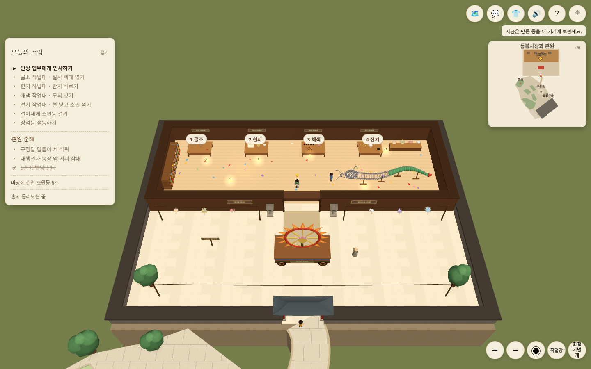
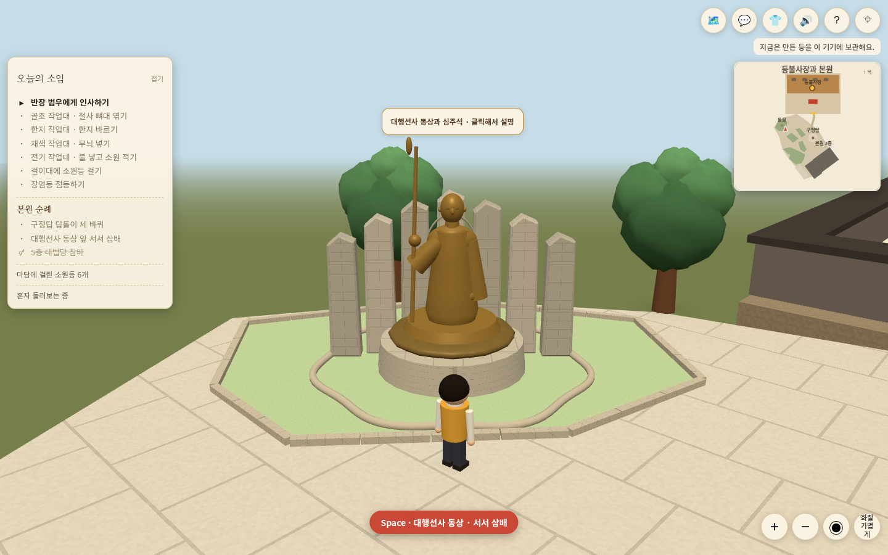
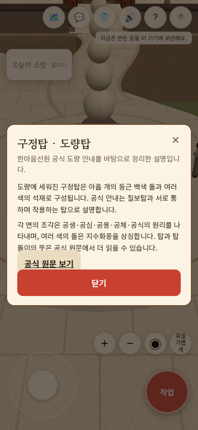

# 등불사장 길 연결·작업대 정면 시점·현장 설명

기준 main 05708b3(PR #38 병합). 건물·작업장·동상·구정탑·칠보탑의 위치·방향은 유지했다. 이전 본원 1층 앞면과 출입구 디자인은 스케치 단계로 남겨 이번 작업에 섞지 않았다.

## 원인과 변경

- 작업장 바닥 렌더는 z26까지, 내부 판정은26.6까지인데 S곡선 길은26.8에서 시작했다. 길 시작을 기존 남문 안쪽25.7까지 연장해 바닥·보행면이 겹친다. 문·마당·원형 타일의 위치나 바깥 길 끝은 바꾸지 않았다. 연결길 검사도 작업장과 바깥 지면의 합집합을 검사하도록 바로잡았다. 예전 길 중앙 검사와 길 길이<12 단정은 안쪽 겹침을 고려하지 않아 전체 테스트에서 실패했고, 새 겹침/실제 바깥 여유 폭 기준으로 갱신했다.
- 기존 카메라는 거리9.5의 플레이어 중심 구도로, 폭28칸에 걸친 네 작업대가 한 화면에 들어오지 않았다. 외부에서 돌린 yaw도 재입장 시 유지했다.
- PC 작업장은 북쪽 작업대 줄을 남쪽에서 정면으로 보는 자동 구도다. 네 작업대의 경계/안내판 높이와 플레이어 발·머리를 HUD·미니맵 사이의 실제 화면 영역에 맞춘다. 작은 창/접힌 HUD에도 다시 계산한다. 장식/구조물을 이동시키지 않는다.
- 작업대에 번호·짧은 이름을 붙이고 실제 제작 상태에 따라 ‘지금’과 완료 표시를 갱신한다. 직접 가까이 가서 제작하는 기존 단계 gate는 유지한다.
- 모바일은 기존 가까운 이동 구도를 유지하며 입장하면 북쪽을 향한다. 직접 회전/확대/눈높이 조작은 같은 방문에서 자동 구도가 덮어쓰지 않는다. ‘작업장’ 버튼은 정면 구도를 복원한다. 작업장 밖으로 한 칸 넘게 나갔다 재입장하면 수동/눈높이 상태를 새 방문 기준으로 초기화한다.
- 동상 앞 접근은 사람과 동상을 함께 보는 구도다. 동상 자체는 회전하지 않는다. 전체 보기·모습 선택·의식·대화/모달은 자동 시점보다 우선한다. 전체 보기에서 작업대 DOM 안내는 숨긴다. 이동은 전환 중에도 실제 렌더된 카메라 방향을 따른다. 동작 줄이기에서는 시점 복원/수동 전환도 즉시 적용한다.

## 개체 설명

구정탑·칠보탑·대행선사 동상을 직접 클릭/터치하면 개별 설명을 연다. 근처에서는 작은 이름/클릭 안내가 표시되며 키보드로도 선택할 수 있다. 메뉴 탭이나 본문 자동 모달은 없다. 삼배·탑돌이 작업과 설명은 분리한다.

가림 판정은 실제 장면의 앞쪽 불투명 표면을 통과하지 않는다. 근접 안내도 가려진 개체에는 표시하지 않으며 가림 계산을 약240ms 간격으로 제한한다. 스프라이트가 있는 장면의 Raycaster에도 카메라를 전달한다. 화면 회전·핀치·취소 이벤트는 개체 클릭을 만들지 않는다. 새 카메라 입력 임계값6px는 작은 터치 흔들림과 실제 드래그를 구분한다.

공식 설명은 직접 요약하고 원문을 연결한다. 원본 사진이나 설명 전체를 배포하지 않는다.

- 구정탑: https://hanmaum.org/content/one_tour_07
- 칠보탑: https://hanmaum.org/content/one_tour_06
- 대행선사 동상·심주석: https://hanmaum.org/content/one_tour_08

## 검증 기록

입구 지면/보행 겹침, PC 화면 투영, 방문/수동/중단/재입장, 탭·드래그·핀치·취소, 앞쪽 벽/숨겨진 조형물, 스프라이트 포함 가림 판정 테스트는 실패를 먼저 확인하고 수정 후 통과했다. 전체110개 테스트와 production build가 통과했다. 기존 Three.js 청크 크기 경고는 유지된다.

독립 리뷰에서 찾은 눈높이 방문 간 잔류는 회귀 테스트로 수정했다. 전체 보기 작업대 안내 숨김, 대화/모달 우선순위, 근접 설명 가림도 반영했다. 스프라이트 카메라 누락은 브라우저에서 발견하고 실제 Sprite가 있는 회귀 테스트로 수정했다.

운영 DB 쓰기·접속 프로토콜·배포 설정·새 라이브러리는 변경하지 않았다. 실제 아이폰 Safari/GPU와 다중 접속 부하, 운영 배포는 검증하지 않았다. 병합·운영 배포는 클로드가 진행한다. 브라우저 동선 최종 결과와 실행 화면은 아래에 추가한다.

최종 브라우저 기록: PC Chromium1440×900/1100×820, 모바일 모형390×844(coarse touch, 입구/동상 확인은DPR3, 설명 유지·복귀 확인은DPR1 포함)에서 실제 키보드/터치 조이스틱으로 이어진 입구를 통과하고 정면 yaw로 맞춰짐을 확인했다. PC 네 작업대 안내는 모두 표시되고 화면/HUD 밖으로 잘리지 않았다. 직접 회전 후 유지·정면 버튼 복원, 동상 접근 구도, 개체 직접 클릭/터치로 구정탑·칠보탑·동상 설명과 공식 링크, 근접 안내의 키보드 Enter, 눈높이 모드 후 새 방문 초기화, 전체 보기 안내 숨김, 법당 실제 걷기 입장/퇴장과 페이지 오류0건을 확인했다.

모바일 pointerup에서 본문을 열면 뒤따르는 호환 click이 새 모달 배경에 닿아 즉시 닫히는 현상을 실제 이벤트 로그로 재현했다. 최종 click에서만 설명을 열고 드래그/핀치/취소는 여전히 제외하는 회귀 테스트를 실패→통과시킨 뒤 모바일 구정탑/칠보탑 설명이 열린 채 유지됨을 확인했다. 최종 전체110개 테스트·build 통과. 일부DPR3 설명 화면 캡처는 소프트웨어 렌더/폰트 준비 중 제한시간을 넘겨, 정상 저장된 일반DPR 모바일 실행 화면으로 대체했다. 이는 실제 아이폰 성능 결과가 아니다. 제작 데이터/단계 gate는 기존 전체 단위 테스트로 확인했고 소원등 새 등록 등 운영 DB 쓰기는 하지 않았다.

## 실행 화면

